# 实验三实验报告

第31组｜2026-11-13

华南农业大学

数学与信息学院、软件学院

大模型辅助的企业股权知识图谱
多跳路径搜索与智能优化

BFS · A* · MCTS · 遗传算法 · 路径价值学习 · 专家规则

软件工程5班 · 第31组

组长：梁镇贤

组员：陈宗波、温文辉、陈宇冲、刘亦达

2026年11月13日

本报告已整合搜索树可视化样例与失败案例分析。
配套附件包括高清 PNG、SVG、完整搜索轨迹 JSON、冻结结果及复核脚本。


---

## 摘要与阅读导航

本实验将企业股权关系图中的2—4跳问答转化为带证据约束的状态空间搜索，独立实现BFS、A*与MCTS，并在A*中融合遗传算法优化的启发函数、路径价值分类器和轻量专家规则。本地Qwen2.5-0.5B-Instruct仅评估真实路径前缀的合法性与价值，搜索答案由程序产生并核验，模型解释与图证据分开保存。

基准含45张互不共享实体的图和405道问题。对测试与OOD的162道问题，以3种预算、8种方法运行3,888次。预算8时，测试集固定A*与GA A*的有效答案率均为99.07%，平均扩展分别为4.120与4.102；BFS为14.81%。但GA在OOD上由固定A*的100.00%降至98.15%。LLM原9题及新增18题配对中未测得搜索成功率或扩展数收益；数值挑战显示，分类头降低误放行的同时带来误拒。结果表明，局部可验证证据有助于有限预算下的搜索排序，GA与LLM的增益则必须分布依赖地分析。

报告同时展示2、3、4跳与MCTS真实搜索树，并用预算耗尽、无专家无效路径、OOD排序退化、真实LLM误判和受控错误评分分析失效机制。全部图表可追溯到附件JSON。本轮仅汇编冻结结果和重放典型案例，没有重新训练、改变问题或增加LLM调用。

关键词：知识图谱；状态空间搜索；遗传算法；路径价值分类；专家系统；大语言模型；证据核验。

表1 任务要求与报告对应

| 任务要求 | 报告位置 | 可复核材料 |
| --- | --- | --- |
| 建模与BFS/A*/MCTS | 第1—2章、第10章 | 数据划分；独立内核；完整trace |
| 启发函数与GA优化 | 第3章、第7章 | ga_history.json；固定/GA对照 |
| LLM三项辅助、禁止直接作答 | 第5、8、11章 | 真实评估、提示、解释与误判记录 |
| 路径分类器与专家规则 | 第4章、第7章 | models.json；学习指标；无专家消融 |
| 四项指标与重点讨论 | 第6—9、13章 | runs.csv；summary；配对区间 |
| 报告、搜索树、失败案例 | 第10—11章及附件 | PNG/SVG；15组轨迹JSON |

阅读提示：第7—9章先看总体结果，第10—11章用具体轨迹解释结果。源码与数据、训练/验证来源、原始模型输出、受控错误注入各自独立，避免把代码验收通过等同于问答100%成功。


---

## 1 实验场景、数据与任务边界

### 1.1 领域选择与前两次实验衔接

实验沿用企业股权关系场景，支持HOLDS（持股）、GUARANTEES（担保）和TRADES（交易）三种有向关系。共享示例直接读取data/raw中的人物、公司、持股、担保和交易CSV，经转换得到16个实体、24条本任务支持的关系和3道示例题。亲属关系不属于实验三关系词表。系统输出可复核的关系证据链，不据此自动作出控制权、信用风险或责任认定。

共享三跳示例为P1→C1→C2→C3，连续持股比例为0.8、0.65、0.35，单一路径乘积为18.2%。这一数值只描述该条路径，既不等于全部路径权益合计，也不直接证明控制关系。报告的问答指标只评价关系与证据的正确性。

### 1.2 图级隔离的可控基准

扩展基准由dataset.py按固定种子7、19、43生成，每张图9道问题，其中2、3、4跳各3道。常规图48个实体，OOD图64个实体；OOD同时降低行业同配概率并增加随机出边，使跨行业与较高分支度更常见。图间实体ID完全隔离，训练/验证/测试/OOD不共享实体。为保证主比较有明确答案，每题植入至少一条有效路径，再打乱边并重建编号以减少顺序线索。

表2 数据规模（直接统计 benchmark.json）

| 划分 | 图数 | 题数 | 实体数 | 边/三元组数 | 2/3/4跳题数 |
| --- | --- | --- | --- | --- | --- |
| train | 18 | 162 | 864 | 3630 | 54 / 54 / 54 |
| validation | 9 | 81 | 432 | 1815 | 27 / 27 / 27 |
| test | 12 | 108 | 576 | 2379 | 36 / 36 / 36 |
| ood | 6 | 54 | 384 | 2000 | 18 / 18 / 18 |

领域图包含构造的企业与证据属性，用于控制分支、干扰和证据错误，不是从真实企业经营场景采集的效果评估。数据构造方式不会因页面显示名简化而改变；原始JSON按字节保留。构造分布与共享CSV属于不同用途，主统计不混入共享案例。

### 1.3 问答输出口径

输入是起始实体、预先给定的关系序列及终点公司/行业/上市属性。虽然问题文字包含“哪些企业”，本实现要求给出一条有效证据路径及其端点，而非枚举所有答案实体；也没有宣称实现开放域自然语言解析。原405题均可答，派生不可答测试在第9章单列，不能与主准确率相混。

来源：data/raw/*.csv；data/lab03/benchmark.json；experiments/lab03/dataset.py。附件report_metrics.json保存本表原始计数，source_manifest.json保存数据SHA-256。


---

## 2 状态空间建模与三套搜索内核

表3 状态、动作、转移与终止条件

| 建模项 | 精确定义 |
| --- | --- |
| 问题 q | q=(v₀, [r₁,…,rL], sector, listed)，L∈{2,3,4}。 |
| 状态 s | s=(P,E)，P为完整实体序列，E为完整边序列；当前节点v=P末项，深度d=|E|。 |
| 初始状态 | P=(v₀)，E=空；不能只按当前节点去重，不同前缀必须保留。 |
| 动作 a | 使用当前节点真实出边；关系等于r(d+1)；目标不在P中；专家开启时需通过证据约束。 |
| 转移 T | 向P追加目标实体、向E追加边ID；单边代价为1，g(s)=d。 |
| 目标条件 | d=L，完整关系序列一致，终点为指定行业及上市属性的公司；返回路径另经有效性检查。 |
| 终止与状态 | found：找到候选；exhausted：候选穷尽；budget_exhausted：仍有候选但预算用尽。valid独立记录证据有效性。 |

### 2.1 BFS与A*

BFS使用FIFO队列，逐层取出状态，不调用启发函数或学习模型。A*使用最小优先队列，按f(s)=g(s)+h(s)排序[1]。下界版h₀=L−d在单位边代价下可采纳，但固定关系长度使所有状态f=L；配合FIFO同分规则，它与BFS表现一致。带非零估值的A*在同分时优先较深前缀，因此加权版的提升包含估值、同分规则和已证明无解剪枝，不能全部归因于GA。

```text
OPEN ← {起点}；扩展计数 ← 0
while OPEN非空 且 扩展计数 < budget:
    s ← FIFO取出（BFS）或最小f取出（A*）；计数加1
    若满足目标：记录候选并独立核验；返回
    枚举真实动作 → 证据规则 → 生成新前缀 → 入队
候选已空返回exhausted；否则返回budget_exhausted
```

### 2.2 MCTS / UCT

MCTS独立实现选择、扩展、模拟与回传，而非调用A*改名。选择使用Q/N+1.414√(ln Nparent/N)，未访问子节点优先[2]；扩展一次树节点计一次预算，模拟在合法出边中均匀采样，到目标reward=1，否则reward=0.125。失败叶非零常数是实现设定，不等价于验证成功。模拟转移逐步计入rollout_steps，实际可能在较少树扩展下找到深层目标。纯MCTS不加载路径分类器或启发前瞻。

有限预算使任何方法都可能未找到现存答案。“预算用尽”只说明本次搜索未完成，不证明图中无解；路径内防环与完整前缀身份也不允许用一个到达节点的失败覆盖其他到达路径。


---

## 3 启发函数设计与遗传优化

### 3.1 参数化估值与局部特征

$$
f(s) = d + h(s)， hθ(s) = (L − d) + Σᵢ₌₁⁶ θᵢ zᵢ(s)
$$

$$
z = (1−x₂, 1−x₃, 1−x₄, 1−x₅, x₆, 1−pML(x))
$$

表4 六维路径特征（与 domain.features 一致）

| 特征 | 取值与可观察含义 |
| --- | --- |
| x₁：剩余跳数 | (L−d)/4；用于路径分类器，不作为z的独立罚项。 |
| x₂：局部后缀潜力 | 余1跳检查下一节点目标属性；余2跳仅探测最多2个子前缀；更早阶段使用当前与后继行业的弱线索。 |
| x₃：有效后继可选性 | min(当前允许后继数,6)/6；随专家开关使用相应真实候选。 |
| x₄：路径证据可信度 | 已走边confidence的最小值，空路径取1。 |
| x₅：阶段化终点匹配 | 公司与上市属性匹配随剩余深度折减；余1/2跳与观测到的目标后缀一致。 |
| x₆：有限后缀死路 | 无合法后继，或在探测上限内完整检查所有候选且不可能到目标时为1；截断未完必须保留未知。 |

固定权重θ=[1.7,0.5,0.6,0.2,1.5,0]。GA只优化前五项，独立A* ML将前五项置零、分类罚项权重设为3；混合版使用GA前五项与λ=0.25的分类项。该融合权重来自既有验证选择，本轮不再调整。成功目标h=0；若余1或2跳已观察到完整合法目标后缀，则h直接设为剩余跳数，不再被学习或LLM评分覆盖。

### 3.2 安全前瞻、剪枝与计费

有界两跳探测只在恰好剩2跳时触发，最多查看2个直接子前缀；若还有候选未检查且没有发现解，不能判死路。只有无后继、终点属性不符或已完整核验无解的后缀才执行proof_pruned。它与“边未核验/失效/低置信度”的expert_rejections是不同概念。分类概率低或LLM低分本身不能硬剪枝。

目标后缀被前瞻观察到后仍需正常入队、出队并付扩展成本，不允许直接返回旁路答案。当前候选、特征与h按完整边前缀缓存，仅在一次搜索内复用；额外探测、出边扫描和证据检查单列。BFS、下界A*及纯MCTS不使用这些估值/证明剪枝。

可采纳性边界：加权罚项和学习估值可能高估真实剩余代价，报告不宣称其拥有经典可采纳A*的最优性保证。所有有效解都满足固定L，故本基准评价有限预算成功率与开销，而非变长最短路最优性。


---

### 3.3 GA设置、收敛与实际收益

$$
J(θ) = 验证集有效答案率 − 0.12 × mean(expanded / 8)
$$

每个种子独立使用其3张验证图、27题。种群14、进化10代（含第0代共11个日志点）、精英2、锦标赛3；算术交叉，高斯变异标准差0.65、概率0.3，权重限制[0,5]。初代明确保留固定h与一组已有验证热启动候选，其余随机生成；不把热启动伪装成从零发现。候选按精确浮点权重缓存，避免四舍五入误合并。

表5 固定h与GA最终验证结果

| 种子 | 固定J | 初代最优J | 最终J | 固定扩展 | GA扩展 |
| --- | --- | --- | --- | --- | --- |
| 7 | 0.936667 | 0.936667 | 0.936667 | 4.2222 | 4.2222 |
| 19 | 0.938333 | 0.938889 | 0.939444 | 4.1111 | 4.0370 |
| 43 | 0.937778 | 0.938333 | 0.938889 | 4.1481 | 4.0741 |

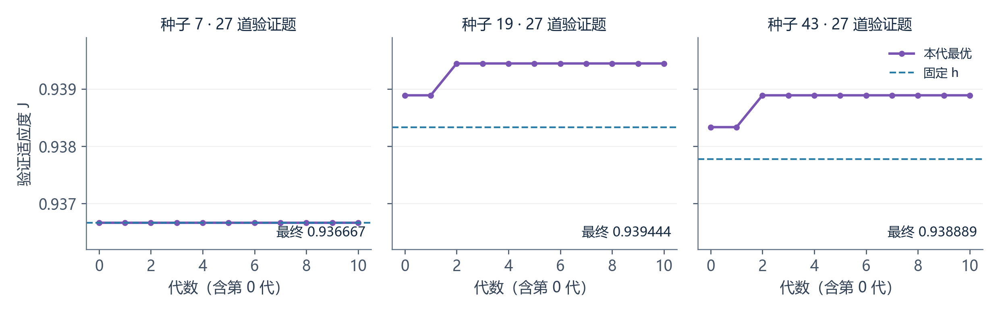

曲线接近直线是当前结果，不是绘图错误：固定h已在各验证集达到100%有效答案率，适应度剩余提升只能来自少量扩展减少；精英保留还使最优值不下降。种子7始终保留固定权重，种子19和43只在第2代出现进一步改善。131、133、132个不同候选被真实评估，但大量权重并不改变离散队列顺序。

合并81道验证题，平均扩展从4.1605降至4.1111，仅减少4次总扩展，约1.19%。原测试预算8中，固定A*与GA同为107/108成功，总扩展仅减少2次；OOD却损失1题。因此“GA有效”应限于已记录的验证适应度改善，不能写成稳定提高答案率。第11.3节展示其OOD退化轨迹。

训练/验证数据隔离防止测试标签直接进入GA适应度，但反复查看已见测试结果仍会产生研究过程层面的选择偏差。原test/OOD在多轮迭代中已被查看，后续同题结果仅作为回归；冻结后的新种子确认单列，不能再次称为从未使用过的盲测。


---

## 4 路径价值学习与规则专家系统

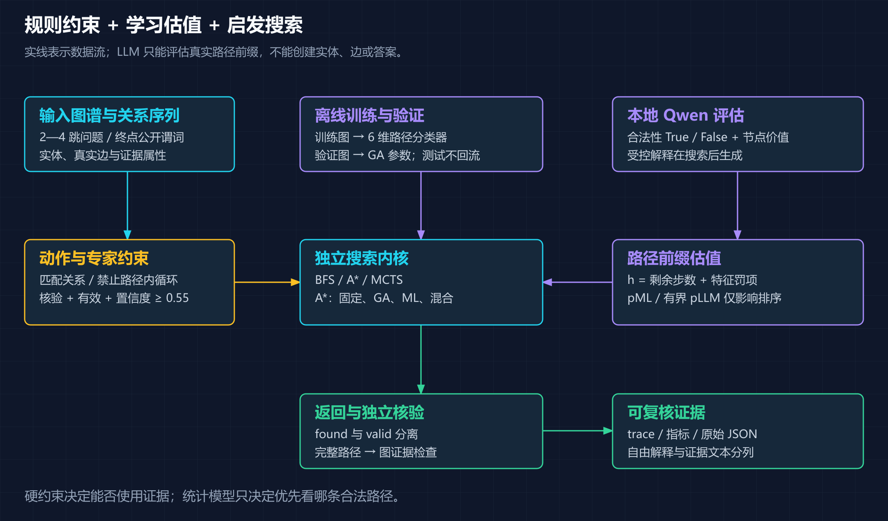

### 4.1 路径价值分类器

对训练图中每道问题枚举合法路径前缀：若该前缀至少存在一条有效目标延伸，标签为1，否则为0。离线穷举只用于制备标签和评估；在线搜索不调用该oracle。训练6维逻辑回归pML=σ(wᵀx+b)，不输入实体ID、目标答案或到答案的真实距离；局部目标谓词仍来自第3章限定的可观察邻域。

类别平衡权重缓解正负样本不均衡，使用700次梯度更新、学习率0.12和L2=0.012。训练配置预先固定；分类阈值0.5用于测试指标。它估计的是“此路径前缀能否延伸”，不是直接分类最终答案实体。

表6 三个路径分类器及独立测试前缀表现

| 种子 | 训练正/负 | 测试前缀 | Precision | Recall | F1 / Brier |
| --- | --- | --- | --- | --- | --- |
| 7 | 437/958 | 983 | 0.8808 | 0.9838 | 0.9294 / 0.0495 |
| 19 | 435/902 | 849 | 0.8846 | 0.9836 | 0.9315 / 0.0443 |
| 43 | 409/884 | 802 | 0.8859 | 0.9925 | 0.9362 / 0.0445 |

### 4.2 轻量专家规则

允许证据必须同时满足verified=True、active=True、confidence≥0.55；阈值是本实验预设策略，不是行业通用标准。另以关系顺序、真实边存在性和路径内防环约束动作。规则负责安全边界，学习模型负责排序，两者不可互相替代。关闭专家作为明确消融，返回的found候选仍由独立验证器标为valid=False，从而暴露而非隐藏风险。


---

## 5 LLM搜索辅助：权限、协议与解释

### 5.1 真实使用的模型

本地模型为Qwen/Qwen2.5-0.5B-Instruct，固定revision为7ae557604adf67be50417f59c2c2f167def9a775[3]。模型清单对7个文件进行SHA-256验证；权重存在用户缓存，不混入代码提交目录。当前报告基于既有CPU真实推断记录，不把网页缓存重放称作本轮重新调用。远程接口仅为可选实现，本报告没有其收费调用结果。

表7 LLM权限及输出限制

| 职责 | 输入与输出 | 硬边界 |
| --- | --- | --- |
| 动作合法性辅助 | 仅依据已走前缀的verified、active和最小confidence；输出True/False。 | 模型判断不替代专家规则。 |
| 路径reward | 真实前缀、问题公开条件；选择A/B/C，对应1/0.5/0。价值p=P(A)+0.5P(B)。 | 只给节点评估值，不创建边或输出答案ID。 |
| 搜索后解释 | 输入已由搜索获得并核验的路径；保留自由解释，另让模型选择有限已核验措辞。 | 不能反向更改搜索结果，未经核验的自由文本不作为证据。 |

### 5.2 接入搜索的数值方式

每题在前两层最多预评分8个真实路径前缀，评分键绑定完整边序列。若模型判合法，采用p；若模型判不合法，采用0.25p以降低优先级，而非删除分支。对未被已知合法后缀覆盖的状态，混合启发增加2(0.5−pLLM)，最多±1且总h不小于0。未评分前缀取0.5，即零调整。

$$
pLLM = p（合法）或 0.25p（不合法）
$$

$$
hLLM = max(0, hθ + 2(0.5−pLLM))
$$

模型提示不包含预先算出的答案ID或专家真值标签。原始True/False概率与额外的有监督隐藏表示分类头分开保存：后者使用冻结Qwen的896维表示，由训练图1,296条前缀、301个唯一提示拟合，不能将它写成原始LLM零样本能力。未见图仍可能出现相同数值提示，因此新提示子集另行统计。

### 5.3 解释的证据落地

自由解释的grounded字段按与程序证据文本精确一致的严格策略认证，不是一般语义正确率。原3段自由解释均未认证，其中一段确实出现图中不存在的机构/学校/学生；另有3次模型在有限核验模板中选措辞，均通过认证。受控措辞保证来自模板与程序核验，不说明模型自由推理能力已经可靠。LATS与Think-on-Graph提供相关搜索辅助思路[4–5]，本实验并未复现其论文基准或直接比较性能。


---

## 6 实验协议、指标与公平性

### 6.1 分组、预算与消融

原主比较对test的108题、OOD的54题分别使用预算4、8、16与8种方法，共162×3×8=3,888条运行；每组保持图、题、预算及随机种子一致。8种方法为BFS、下界A*、固定A*、GA A*、ML A*、纯MCTS、GA+ML+专家混合、关闭专家的混合。LLM因真实推断较慢采用独立小样本配对，不混充全部3,888条运行。

表8 指标定义与分母

| 指标 | 统计定义与解释 |
| --- | --- |
| 答案准确率 / 有效答案率 | valid题数/本组题数；要求端点符合问题且每条边真实、顺序正确并通过证据规则。found不必valid。 |
| 平均扩展节点数 | 所有题expanded的平均，包括失败题；BFS/A*为出队状态，MCTS为树扩展节点。 |
| 推理步数 | 成功且有效路径的边数均值mean_hops_success；无有效解时为null，不用0补值。 |
| 冗余路径占比 | 每次运行中，被登记的完整路径重复到达已有端点的比例，再按题求均值。不是全图潜在冗余率。 |
| 补充成本 | total_work=expanded+rollout_steps；证据候选检查、含关系/环过滤的出边扫描、启发探测、LLM与训练耗时另列。 |
| 补充错误与不确定性 | 无效答案率、预算耗尽率；同题差值按整图cluster bootstrap，1,000次重采样取约95%区间。 |

冗余路径在实现中指terminal_mark实际登记的深度L状态：BFS/A*通常在出队时登记，MCTS也登记模拟到达的终点。被生成但未出队、或已证明剪枝的完整候选不一定进入分母，因此零冗余不能说明图无分支。另有重复(node,depth)扩展比例redundancy_ratio，与上述完整路径口径不能混用。

### 6.2 成本与统计边界

统一扩展预算不是统一计算预算。A*的前瞻与规则检查、MCTS的rollout、LLM预评分都可能增加额外工作。mean_total_work也不是全算力，未包括前瞻、训练或模型推断。壁钟时间来自单次串行记录，受机器负载影响，不作稳定加速比结论。配对区间保留图内相关性；测试12个图、OOD仅6个图，区间仍受小样本限制。

报告生成与复核环境：Windows 11专业版，Intel Core i5-13500H，约16GB内存；Python 3.13.9、NumPy 2.4.6、PyTorch 2.10.0、Transformers 5.9.0。此处为当前环境核验，不据此重新解释历史推断计时。依赖版本记录见evidence/environment.json。


---

## 7 主比较结果

表9 测试集：预算8，108题

| 方法 | 有效答案 | 均扩展 | 成功步数 | 冗余路径 | 无效答案率 |
| --- | --- | --- | --- | --- | --- |
| BFS | 16/108 (14.81%) | 7.861 | 2.000 | 0.463% | 0.00% |
| A* 下界 | 16/108 (14.81%) | 7.861 | 2.000 | 0.463% | 0.00% |
| A* 固定 | 107/108 (99.07%) | 4.120 | 2.991 | 0.000% | 0.00% |
| A* GA | 107/108 (99.07%) | 4.102 | 2.991 | 0.000% | 0.00% |
| A* ML | 107/108 (99.07%) | 4.139 | 2.991 | 0.000% | 0.00% |
| MCTS | 85/108 (78.70%) | 4.139 | 2.918 | 1.435% | 0.00% |
| 混合 | 107/108 (99.07%) | 4.102 | 2.991 | 0.000% | 0.00% |
| 混合无专家 | 92/108 (85.19%) | 4.120 | 2.924 | 0.000% | 14.81% |

表10 OOD：预算8，54题

| 方法 | 有效答案 | 均扩展 | 成功步数 | 冗余路径 | 无效答案率 |
| --- | --- | --- | --- | --- | --- |
| BFS | 5/54 (9.26%) | 7.907 | 2.000 | 0.000% | 0.00% |
| A* 下界 | 5/54 (9.26%) | 7.907 | 2.000 | 0.000% | 0.00% |
| A* 固定 | 54/54 (100.00%) | 4.241 | 3.000 | 0.000% | 0.00% |
| A* GA | 53/54 (98.15%) | 4.222 | 2.981 | 0.000% | 0.00% |
| A* ML | 53/54 (98.15%) | 4.278 | 2.981 | 0.000% | 0.00% |
| MCTS | 41/54 (75.93%) | 4.444 | 2.854 | 1.252% | 0.00% |
| 混合 | 53/54 (98.15%) | 4.222 | 2.981 | 0.000% | 0.00% |
| 混合无专家 | 44/54 (81.48%) | 4.148 | 2.932 | 0.000% | 16.67% |

固定、GA与混合A*在测试预算8同为107/108成功；GA与混合只比固定版少2次总扩展。OOD固定版54/54成功，GA、ML及混合为53/54。专家关闭使测试16/108、OOD9/54题返回无效证据链，说明只匹配终点并不足以回答“有效证据路径”。

BFS的成功路径均值恰为2，并非它找到更短推理；预算8下它主要只完成最浅问题。固定A*的约3跳均值反映更均衡地完成2、3、4跳题，不能跨成功子集把路径均值当优化目标。

路径冗余大多很低，是短路径、首个答案即停与证明剪枝共同造成的观测结果。MCTS会模拟多个终点，故其冗余路径占比更高。全部预算4/8/16明细保存在summary.json及runs.csv，未删除失败或仅挑最好种子。


---

### 7.1 准确率与预算敏感性

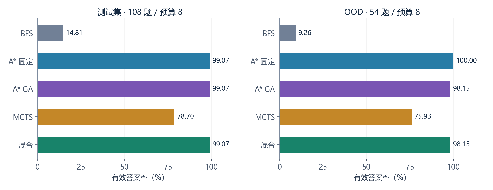

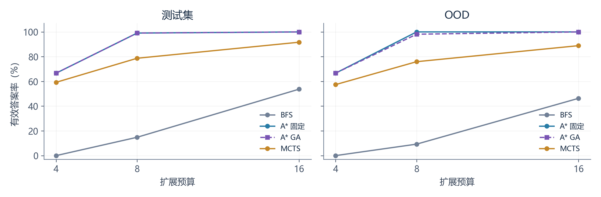

预算4时，A*最多支付起点到三跳终点的4次出队，不能完成四跳解所需的至少5次出队，因此固定/GA在test与OOD均为66.67%。这不是把4跳问题改成3跳，也不是GA失灵；预算在建模口径上已有硬下限。MCTS能在树扩展之外模拟到4跳，故预算4结果不能不加成本说明地与A*比较。

预算16时，固定/GA/混合在原test与OOD均达到100%，而BFS分别为53.70%与46.30%，MCTS为91.67%与88.89%。这些差异支持“有区分度的局部证据帮助有限预算排序”，不支持“启发式在任意图或相同总算力下必然更快”。


---

### 7.2 搜索成本与配对不确定性

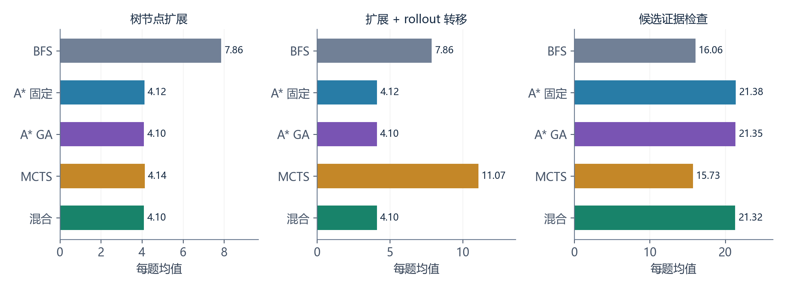

表11 测试集预算8：补充成本（每题均值）

| 方法 | 扩展+模拟 | 候选证据检查 | 全部出边扫描 |
| --- | --- | --- | --- |
| BFS | 7.861 | 16.056 | 33.713 |
| A* 固定 | 4.120 | 21.380 | 47.713 |
| A* GA | 4.102 | 21.352 | 47.657 |
| MCTS | 11.074 | 15.731 | 31.500 |
| 混合 | 4.102 | 21.324 | 47.611 |

测试预算8时，固定A*比BFS平均少扩展47.59%，却多检查约33.16%的候选证据，全部出边扫描也更多。这说明搜索排序收益以额外局部信息为代价。MCTS树扩展均值4.139看似接近A*，加上rollout后为11.074；若只报告树扩展就会低估其开销。

表12 GA相对固定A*的配对答案率差（预算8）

| 划分 | 差值/百分点 | 整图bootstrap约95%区间 | 图簇数 |
| --- | --- | --- | --- |
| test | +0.000 | [+0.000, +0.000] | 12 |
| ood | -1.852 | [-5.556, +0.000] | 6 |

测试差值及区间为0，表示这批同题有效性结果相同，不等于总体差异的统计证明；OOD区间触及0且图簇少，不能据此宣称显著提升。GA在验证集更优但在OOD失题，正是需要保留的泛化风险证据。

本实验未测得稳健的LLM搜索加速。原9题评估记录中模型推断累计107.033秒，隐藏表示分类头训练累计127.907秒；新增18题前缀评估196.902秒。三者属不同过程，不能与不含加载/训练的单次search.elapsed_ms拼成“公平总耗时”。


---

## 8 LLM实测、原始输出与分类头对照

表13 合法性判断：原始模型和隐藏表示分类头

| 样本 | 版本 | 正确率 | 误放行 | 误拒 | 均衡准确率 |
| --- | --- | --- | --- | --- | --- |
| 原9题/72前缀 | 原始 | 98.61% | 1 | 0 | 95.45% |
| 原9题/72前缀 | 分类头 | 100.00% | 0 | 0 | 100.00% |
| 新18题/144前缀 | 原始 | 99.31% | 1 | 0 | 95.45% |
| 新18题/144前缀 | 分类头 | 99.31% | 1 | 0 | 95.45% |
| 100数值挑战 | 原始 | 88.00% | 12 | 0 | 93.10% |
| 100数值挑战 | 分类头 | 97.00% | 1 | 2 | 91.73% |

原9题固定选择每个种子的第一张测试图、前3题，覆盖2/3/4跳；混合与加入LLM均9/9成功、每题扩展4次。新18题的无LLM、原始LLM与分类头三组均18/18成功，总扩展均78次，即每题4.333次。合法性更准不等于端到端搜索更好：非法边已受规则阻挡，已知后缀又优先于模型排序。

新144前缀中133合法、11不合法，“永远判断合法”已有92.36%准确率，因此必须同时看误放行与均衡准确率。按合法性提示是否在分类头训练提示中出现筛选后，仅37条前缀属于未见提示子集（不等同37个唯一文本），原始与分类头均36/37正确，仍有1次误放行；图级隔离不代表语言输入完全不重合。

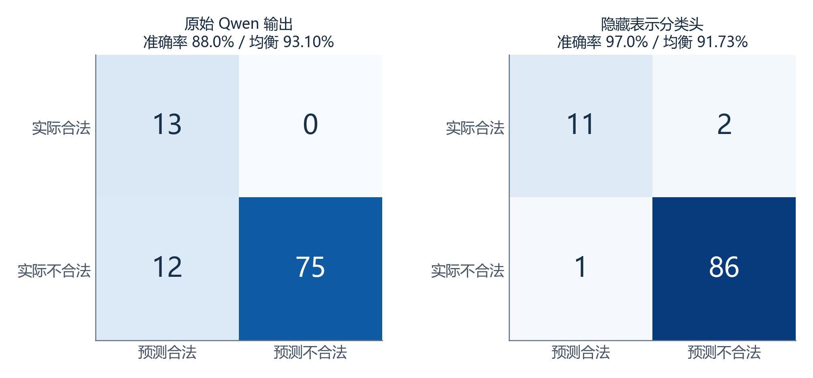

数值挑战中分类头准确率由88%升至97%，但合法召回由100%降至84.62%，均衡准确率由93.10%降至91.73%。它以增加误拒换取更少误放行，不能被包装成全面提升。案例细节见第11.4节；真实误判与人为注入评分严格分列。


---

## 9 冻结后确认与不可答测试

第四阶段先固定策略、代码与参数，再使用新种子生成24图216道可答题，进行5,184组前后配对（216×3预算×8方法）。这是该阶段的冻结后确认，本次报告只是复核归档。常规108题与分布变化108题分别统计；旧test/OOD仍仅作为已见回归。

表14 冻结后新图可答题：预算8（每组108题）

| 方法 | 常规成功率 | 常规扩展 | 变化成功率 | 变化扩展 |
| --- | --- | --- | --- | --- |
| BFS | 17.59% | 7.935 | 5.56% | 7.972 |
| A* 固定 | 100.00% | 4.111 | 99.07% | 4.250 |
| A* GA | 100.00% | 4.120 | 99.07% | 4.259 |
| MCTS | 72.22% | 4.852 | 71.30% | 4.917 |
| 混合 | 100.00% | 4.120 | 99.07% | 4.259 |

对同批问题将目标行业替换为图中不存在的行业，派生216道明确不可答题。固定A*与混合在预算8/64形成864组前后配对，评价“是否正确穷尽”，而不是将其计入可答题准确率。此夹具测试的是有限图中的明确无解，不是开放世界语义不可回答。

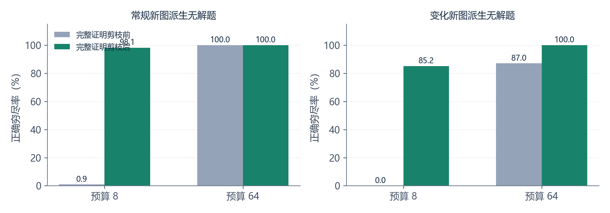

预算8时，混合在常规新图正确穷尽由1/108增至106/108，变化图由0/108增至92/108；均无错误found。预算64时两组均108/108正确穷尽，平均扩展分别约2.843与3.843。可答题并未因此全部预算内成功：变化图仍有一道4跳题在预算8耗尽，第11.3节保留该失败。

来源：reliability/protocol.json、confirmation.json、failure_analysis.json；报告附件复制冻结结果，未根据确认集再次选择权重。


---

## 10 搜索树可视化样例

### 10.1 三跳完整状态树与读图约定

图8来自test-7-0-Q7，关系为持股→持股→交易，终点要求金融行业上市公司。颜色区分有效解、已扩展、待扩展、专家拒绝和已证明无解；#数字是扩展次序。一个方框对应完整边前缀，不按实体ID合并：同一N7出现在不同路径位置时是不同状态。图中保留全部12个路径状态和17个事件，无截取。

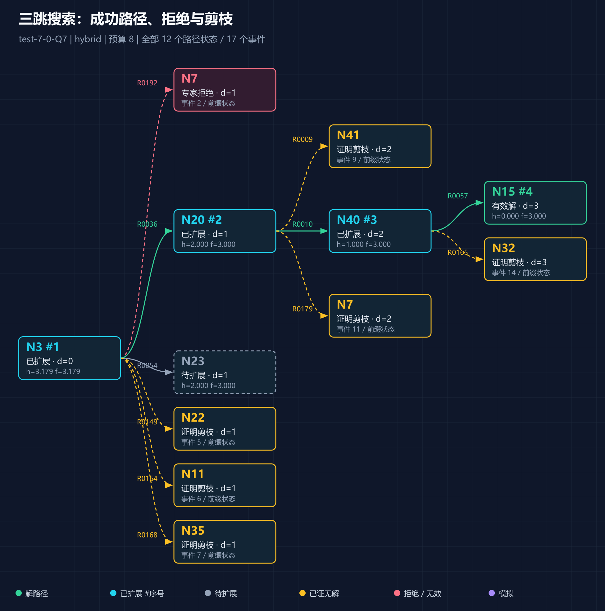

有效路径为N3→N20→N40→N15，边R0036、R0010、R0057，置信度0.741、0.944、0.950，全部已核验且有效。N40虽属制造行业，仍可作为中间实体；题目只约束终点行业。一次专家拒绝与六次proof_pruned分别统计，不能合称七次证据错误。

附件：S02_three_hop.json保存完整图、查询、模型/权重、trace及离线oracle的2条有效路径；图文件09_tree_three_hop.svg/.png。


---

### 10.2 两跳与四跳样例

表15 覆盖2—4跳的真实成功路径（同图、混合、预算8）

| 样例 | 关系序列 | 返回路径（短ID） | 扩展数 |
| --- | --- | --- | --- |
| S01 / Q0 / 2跳 | 持股→交易 | N0→N21→N37 | 3 |
| S02 / Q7 / 3跳 | 持股→持股→交易 | N3→N20→N40→N15 | 4 |
| S03 / Q2 / 4跳 | 持股→持股→担保→交易 | N2→N30→N14→N38→N41 | 5 |

两跳示例的R0087、R0084置信度分别为0.926和0.922，终点N37为新能源上市公司。完整两跳树较高，另附08_tree_two_hop.svg/.png；报告以表和完整JSON呈现，不压缩成不可读缩略图。四跳例展示短程前瞻之外仍需逐步扩展。

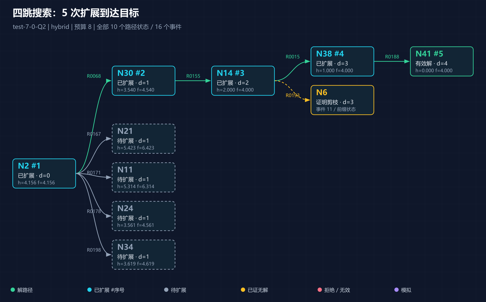

表16 四跳解的证据核验

| 边ID（test-7-0前缀省略） | 关系 | 置信度 | 核验/有效 |
| --- | --- | --- | --- |
| R0068 | HOLDS | 0.838 | True/True |
| R0155 | HOLDS | 0.821 | True/True |
| R0015 | GUARANTEES | 0.801 | True/True |
| R0188 | TRADES | 0.703 | True/True |

图9不是把正确路径单独画成直线：它保留根部的N21/N11/N24/N34候选及N6证明剪枝。正确路径很短与搜索树没有分支是两回事。JSON中的trace按事件顺序列出生成、扩展、剪枝和最终解，能逐步还原。


---

### 10.3 MCTS：模拟不等于树扩展

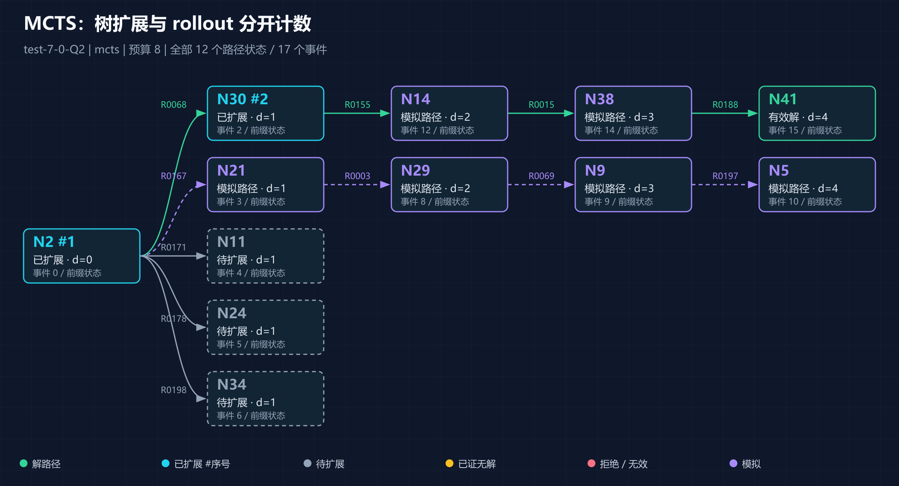

固定种子7、预算8时，MCTS先扩展根N2并生成5个一跳候选；第一次均匀rollout走N21→N29→N9→N5，未达到目标。随后扩展N30，第二次rollout走N14→N38→N41而成功。总计2次树节点扩展、7次模拟转移，total_work=9。

表17 同题Q2的扩展与模拟成本

| 方法 | 预算 | 有效答案 | 树扩展 | 模拟步数 | 扩展+模拟 |
| --- | --- | --- | --- | --- | --- |
| 混合 | 8 | 是 | 5 | 0 | 5 |
| 纯MCTS | 8 | 是 | 2 | 7 | 9 |
| BFS | 8 | 否 | 8 | 0 | 8 |

图10中相同实体若从不同前缀到达，仍是独立状态；同一前缀的generated、expanded或rollout事件会合并成一个方框，但完整事件不丢失。绿色只表示实际返回的有效路径，不表示该路径上每个节点都作为树节点扩展。

一个例子中MCTS先找到答案，不能推断其总体优于A*。在原测试预算8的108题中，MCTS成功85题，而固定A*为107题；本图只解释模拟机制，不估计总体发生频率。模型概率不参与纯MCTS rollout，成功也不是LLM直接回答。

可复核材料：S04_mcts_four_hop.json、S03_four_hop.json；Q2的BFS同题结果见raw/runs.csv。重放参数包含随机种子，重复运行仅耗时可能变化。


---

## 11 失败案例与原因定位

### 11.1 BFS预算耗尽：目标已生成但未出队

同一test-7-0-Q7，混合在预算8内4次扩展成功，BFS耗尽8次扩展仍未出队目标。独立oracle存在2条有效路径，因此状态应为budget_exhausted，而非“图中无答案”。图11将已生成的目标N15保留为灰色，避免误把观察到目标当已完成搜索。

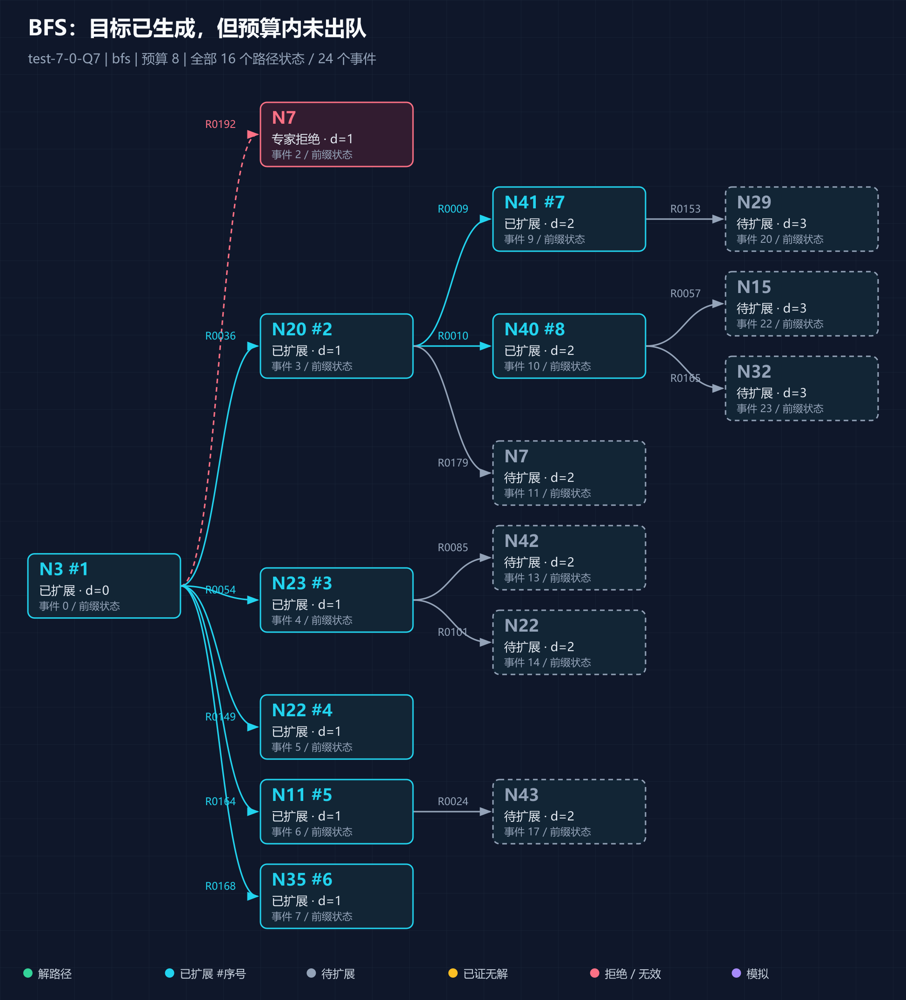

原因是FIFO对同层候选不区分潜力，先扩展N23、N22、N11、N35等分支。它遵守BFS语义，并非漏接图边。可采取提高预算或选择带局部证据的启发搜索；不能为美化结果把生成目标改成不计费返回。附件F01_bfs_budget.json与S02_three_hop.json同图同题同预算。


---

### 11.2 预算硬下限与无专家无效路径

预算硬下限：四跳Q2在混合预算4时已生成终点，却只支付根与3个中间前缀的4次出队；有效目标还需第5次。提高预算为8后5次扩展成功，见F02_minimum_budget与S03_four_hop。应提示预算不足，而非修改问题跳数或跳过目标计费。

证据无效：Q0关闭专家后，程序3次扩展返回N0→N43→N47，终点符合新能源上市属性，但第一条R0039的verified=False、active=False。尽管confidence=0.936很高，三条件合取仍不成立。系统保留found=True、valid=False，不能将它记为正确答案。

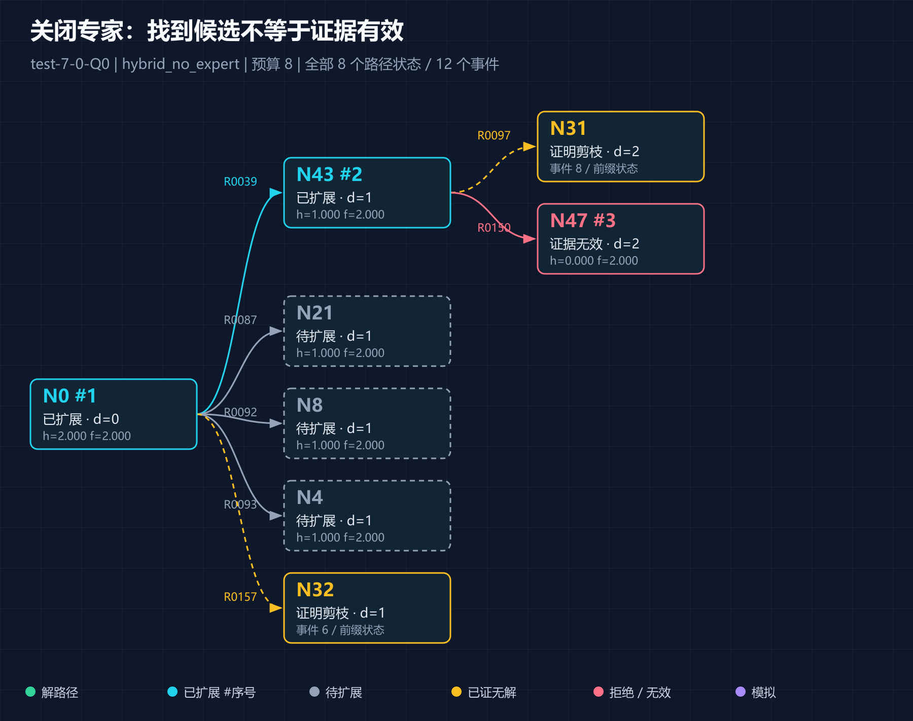

表18 同题Q0的专家开关对照

| 设置 | 返回路径 | found / valid | 关键原因 |
| --- | --- | --- | --- |
| 专家开启 | N0→N21→N37 | True / True | 真实边均核验有效 |
| 专家关闭 | N0→N43→N47 | True / False | R0039未经核验且已失效 |

修正策略是继续让规则决定边是否允许，概率只作排序；模型高分或较大confidence都不能越过verified/active。无专家组作为消融仍保留以展示风险，不应“修正”成与专家组完全一致。全组无效答案率见第7章，个例不替代总体统计。


---

### 11.3 GA的OOD退化与新图残余失败

原OOD预算8中，ood-19-0-Q8是GA相对固定A*唯一失题。它要求持股→持股→担保→持股，到新能源上市公司，独立oracle只有1条有效路径。固定A*恰在第8次扩展到N63；GA先多扩展N34，再进入正确的N51分支，预算在目标出队前用完。

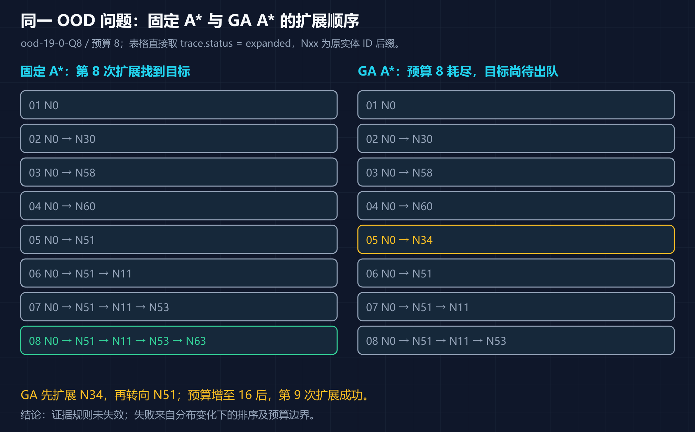

表19 OOD失败的参数不变恢复对照

| 方法 | 预算 | 状态 | 扩展 | 证据结论 |
| --- | --- | --- | --- | --- |
| 固定A* | 8 | found | 8 | 有效解 |
| GA A* | 8 | budget_exhausted | 8 | 仍有候选 |
| GA A* | 16 | found | 9 | 同一有效解 |

此例支持分布变化下的排序退化：验证适应度奖励的局部特征组合未能在更大、行业同配更弱的图上保持最优次序。证据规则和终点验证未出错；需要的是更稳健的参数选择、扩大验证分布或在预算耗尽时明确不确定，而不是删掉失败题。完整GA树另附14_tree_ood_ga.svg/.png。

冻结后的变化图reliability_confirmation_shift-7001-2-Q2也有残余失败：预算8下固定、GA、混合均耗尽；GA已做15次证明剪枝，仍不能保证及时找到解。本次按原参数重放，预算16时第10次扩展成功，oracle有2条有效路径。F07/F08保留此对照，说明已证无解剪枝提升可靠性，但不保证任何有限预算的完备性。


---

### 11.4 真实LLM误判、解释失真与错误评分

真实误放行：新增图reliability_confirmation-9001-0-Q1的R0105，提示明示verified=True、active=True、minimum_confidence=0.26，阈值0.55；原始模型和分类头均判合法，分类头概率约0.8723。专家规则仍判不合格，故合法性判断错误不自动等于最终错误答案。

表20 数值挑战中分类头的全部3个错误

| confidence | 规则真值 | 原始模型 | 分类头 | 分类头合法概率 |
| --- | --- | --- | --- | --- |
| 0.0 | False | True | True | 0.9778 |
| 0.62041 | True | True | False | 0.2947 |
| 0.57637 | True | True | False | 0.0169 |

三例均verified=True且active=True：0.0应拒却被放行；0.62041与0.57637应允许却被拒。数字精度变化使拟合的隐藏表示边界失稳；后处理输出为规范布尔值，并不能保证语义判断正确。规则可拦非法边，但错误拒绝仍可能压低合法分支排序。

自由解释失真：原test-7-0-Q1输出中出现“教育机构1”“学校33”“学生45”，这些不是已核验路径中的实体。另两段未通过精确文本认证不必然都属语义幻觉，故报告只称3/3“未认证”，不把0/3认证率写成0%语义正确率。受控模板3/3认证来自程序限定事实，不可归功为开放式生成已经可靠。

### 11.5 人为错误评分反例（非真实模型幻觉率）

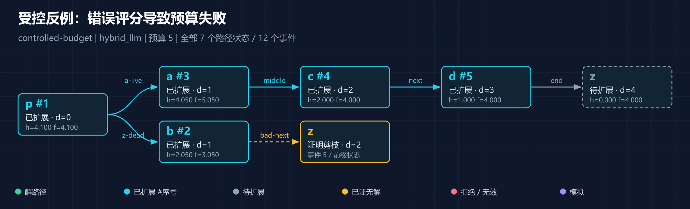

在固定微型4跳图、预算5、专家开启、零系数中性分类器和0.1弱主题权重下，中性评分沿p→a→c→d→z在5次扩展成功；把有效首边评分置0、干扰首边置1后，先扩展b，最终z待出队而预算耗尽。中性树另附16_tree_controlled_neutral文件。原9题受控评分试验中，专家开启无效答案0/9，关闭3/9；这些仅说明机制，不能当真实模型幻觉发生率。


---

## 12 优化迭代、完整性与工程验收

表21 归档迭代：原测试集混合方法预算8（108题）

| 阶段 | 有效答案率变化 | 平均扩展变化 | 主要变化与代价 |
| --- | --- | --- | --- |
| 一跳证据 | 81.48% → 97.22% | 5.380 → 4.602 | 引入任务局部证据；已见同题回归 |
| 精确计算与缓存 | 97.22% → 97.22% | 4.602 → 4.500 | 减少重复检查；候选证据检查32.176→19.713 |
| 有界两跳后缀 | 97.22% → 99.07% | 4.500 → 4.102 | 多解2题；检查19.713→21.324 |
| 安全否定剪枝 | 99.07% → 99.07% | 4.102 → 4.102 | 可答题不变；派生无解正确穷尽显著改善 |

表21各阶段来自独立归档比较，并非本轮重复调参。增加局部信息、减少重复计算和提前排除已证明无解分别解决不同问题；某一阶段的改进不能全部归为GA或LLM贡献。重复使用验证集和已见test/OOD有过拟合风险，因此仍保留每轮失题与新图确认。

### 12.1 运行时完整性

学习产物不只校验“文件存在”：GA历史代数连续性、最终权重、验证图来源和冠军适应度均可重放；分类器核对训练图、特征、正负样本数与误差。缺失或损坏时明确拒绝或提示，不能暗中用固定权重/中性概率冒充已训练模型。分类指标异常不再透传到页面造成数值渲染崩溃。

LLM记录还验证图与问题指纹、完整路径前缀、协议、模型身份、输出结构与数值范围。未评分前缀保持中性，解释生成权限与搜索分离。这些工程措施保护展示真实性和可复核性，不改变BFS/A*/MCTS的算法定义。

表22 2026-11-13既有代码审查记录（非问答准确率）

| 核查项 | 记录结果 |
| --- | --- |
| Python测试 | 432项通过，0项跳过 |
| 浏览器功能与异常数据 | 54项通过（11功能+8工作台+32文案+3损坏数据） |
| 独立随机图搜索验证 | 13,500次，0个内核验证失败 |
| 冻结结果重放 | 3,888条主运行、33代GA、3个分类器及LLM证据复核 |
| 当前/备份运行核对 | 40次HTTP对照；数据快照一致、无警告 |

以上数字来自同日已保存的代码审查验收JSON，报告附其原件，而非本轮生成报告时重新宣称全部完成一次审查。本轮另核对图表数据、典型轨迹、DOCX/PDF版式与保护文件指纹；相应材料验收结果写入delivery_validation.json。测试通过证明检查条件成立，不表示所有题都能在任意预算下答对。


---

## 13 讨论、局限与迁移思考

### 13.1 启发式为什么比盲搜有效

BFS不区分同层路径潜力，分支数为b、深度为L时搜索量可随b的L次幂增长。当前任务中下界h₀没有区分度，因此仅换成优先队列并未改善结果。真正有效的是关系条件下的一/两跳目标证据、已核验无解后缀和排序规则，它们把预算分配给更有机会完成的路径。代价是额外边扫描与检查；因此结论应为“减少无关扩展”，而非无条件降低总算力。

### 13.2 GA收益与过拟合

GA完成了从验证成功率/扩展数到启发参数的自动优化流程，但强手工基线、有限问题规模和离散排序让适应度改善很小。种子7不变、其他两种子仅少量上升，正是应提交的真实结果。OOD失题与新图中GA平均扩展略高于固定版，说明验证最优不等于跨分布最优。后续可预注册更广验证分布、增大图级留出与重复种子，在不反复查看测试答案的情况下评估，而非强行画出上升曲线。

### 13.3 LLM优势与幻觉风险

LLM的潜在作用是对难以手工编码的语义线索给出局部价值，输出受限也便于审计；但本基准条件明确、规则强且只有0.5B模型，原9题和新增18题均未观察到搜索收益。合法性误判、数字精度偏移和自由解释伪造实体均被记录。混合系统应让外部验证器守住动作和证据边界，模型仅排序；即使证据都合法，错误高分仍会消耗预算并导致失题。

### 13.4 局限、可选迁移与结论

限制包括：构造图与固定关系模板、短2—4跳、一条解而非全答案集合、专家阈值依赖输入属性、原测试已多轮查看、图簇及LLM样本较少、未比较多个模型或等总算力。派生无解只是缺失行业夹具，不代表开放世界可判定性。原始训练与推断耗时保留但没有充分重复，不给稳定时延优越性结论。

迁移到数学定理证明时，状态可替换为当前证明义务与证明历史，动作是可核验推理规则，终止由证明检查器判定；迁移到规划时，状态是世界配置与计划前缀，动作需满足前置条件、转移遵守效应、终止满足目标。GA/ML/LLM仍只优化优先级，安全与正确性交给外部验证器；两类任务的状态空间、环处理与成本函数需重新定义，不能原样套用固定关系长度的结论。

本实验实现了要求的三套搜索内核、GA优化、路径学习、专家规则与受限LLM辅助，并以真实统计、完整搜索树和失败分析说明其效果与边界。核心成果是可复核的混合搜索实验系统，而非保证GA/LLM始终提高准确率的新算法。


---

## 参考文献与证据来源

[1] Hart P E, Nilsson N J, Raphael B. A Formal Basis for the Heuristic Determination of Minimum Cost Paths[J]. IEEE Transactions on Systems Science and Cybernetics, 1968, 4(2): 100–107. DOI: 10.1109/TSSC.1968.300136.

[2] Kocsis L, Szepesvári C. Bandit Based Monte-Carlo Planning[C]//Machine Learning: ECML 2006. 2006: 282–293. DOI: 10.1007/11871842_29.

[3] Qwen Team. Qwen2.5-0.5B-Instruct Model Card[EB/OL]. 固定版本：7ae557604adf67be50417f59c2c2f167def9a775，访问日期：2026-11-13。模型身份、参数规模及使用方式参见官方模型卡。

[4] Zhou A, Yan K, Shlapentokh-Rothman M, et al. Language Agent Tree Search Unifies Reasoning, Acting, and Planning in Language Models[C]//Proceedings of the 41st International Conference on Machine Learning. PMLR, 2024, 235: 62138–62160.

[5] Sun J, Xu C, Tang L, et al. Think-on-Graph: Deep and Responsible Reasoning of Large Language Model on Knowledge Graph[EB/OL]. arXiv:2307.07697, 2023（本报告按核实的预印本引用）。

外部文献用于解释经典方法和相关工作，不作为本项目指标来源。原始期刊元数据、会议页面与固定模型卡已核对，访问记录保存在evidence/reference_checks.json。

表23 报告中实验结论的本地证据定位

| 结论/图表 | 附件源记录 |
| --- | --- |
| 数据与核心身份 | source_manifest.json；report_metrics.json |
| 主准确率、步数、冗余与成本 | raw/runs.csv；raw/summary.json |
| GA曲线与参数 | raw/ga_history.json；report_metrics.json中的ga_validation |
| 分类器指标 | raw/models.json；raw/learning_metrics.json |
| 原始LLM与解释 | raw/llm_summary.json；raw/llm_audit.json；raw/llm_explanations.json |
| 新图、数值挑战与真实误判 | raw/reliability/llm_confirmation.json；raw/reliability/failure_analysis.json |
| 冻结后确认、派生无解 | raw/reliability/protocol.json；raw/reliability/confirmation.json |
| 人为错误注入 | raw/hallucination_stress.json；cases/F10与F11 |
| 工程验收 | code_audit_20261113.json；delivery_validation.json |

表23路径以deliverables/lab3/evidence为根。raw文件逐字节保留，图中仅简写实体/边ID。模型权重与历史ZIP未重复打包：权重文件清单见原项目data/lab03/llm_model_manifest.json；历史ZIP等项目保护文件的SHA-256见reproduce/qa/protected_before.json。


---

## 附录 A 复现与附件使用说明

### A.1 只读复核现有结果

在项目根目录打开PowerShell。以下两条命令不会重建主实验，也不调用LLM；第一条复核本报告的轨迹、统计与文件，第二条复核包含历史阶段的完整项目证据链。后者依赖原归档已随项目保留。

```text
python -B -X utf8 deliverables/lab3/reproduce/verify_delivery.py
python -B -X utf8 -m experiments.lab03.verification
```

### A.2 重新运行算法（会写入 outputs，先备份）

```text
python -m pip install -r requirements-lab03.txt
python -B -X utf8 scripts/prepare_lab03.py
python -B -X utf8 main.py lab03 demo --method hybrid
# 仅在明确需要重新做真实模型推断时执行：
python -B -X utf8 scripts/prepare_lab03_model.py
python -B -X utf8 scripts/prepare_lab03.py --llm
```

本次未执行上述重建命令。重新运行后应整套更新相关证据，而不是让新模型/权重与旧指标混用。重新生成本报告请使用reproduce内的独立脚本；不要调用旧lab03 report/all入口来替代，它会联动旧材料流程，且不能保证只生成本次需要的文件。

### A.3 搜索树与失败材料索引

表24 重点附件定位

| 用途 | 文件/编号 |
| --- | --- |
| 三跳主搜索树 | figures/09_tree_three_hop.svg/.png；cases/S02_three_hop.json |
| 2跳、4跳、MCTS | figures/08、10、11；cases/S01、S03、S04 |
| BFS/最小预算/无专家失败 | figures/12、13；cases/F01、F02、F03 |
| OOD与新图残余失败 | figures/14、18；cases/F04—F08 |
| 证明穷尽的不可答样例 | figures/15_tree_no_answer；cases/F09_proved_no_answer.json |
| 人为评分误导成对样例 | figures/16、17；cases/F10、F11 |
| 完整索引与材料验收 | evidence/case_index.json；figure_index.json；delivery_validation.json |

表24中figures/相对本目录，cases/指evidence/cases/；简写编号的完整文件名见图片与案例索引.html。F09将目标行业替换为图中不存在的行业，预算8下仅扩展根1次、证明剪枝6个候选后返回exhausted，oracle为0条解。它不是F01那样仍有候选的budget_exhausted，也不计入可答题准确率。

本目录仅含报告、图片、结果与复核脚本，不生成PPT、视频或独立重复的失败分析文档。成员职责与协作安排见附录B；课程平台项目、组员关联与管理员提交仍由小组自行确认。


---

## 附录 B 成员分工与协作安排

### B.1 成员职责

本节按实验模块拟定成员职责，以主要负责模块和协作事项明确任务边界。各模块围绕统一的数据、接口与评价口径进行衔接，具体执行及交接由小组结合实际协作情况确认。

表25 成员分工与协作安排

| 成员 | 主要负责模块 | 具体职责与协作事项 |
| --- | --- | --- |
| 梁镇贤<br>（组长） | 总体设计、A*搜索与系统集成 | 统筹需求拆解、状态空间建模和模块接口；负责A*搜索、预算与终止条件设计，衔接启发函数、学习评估器和专家约束；组织模块联调与端到端回归，统筹算法说明、系统讨论和最终验收。 |
| 陈宗波 | 启发函数优化与路径价值学习 | 负责路径特征、参数化启发函数与GA适应度设计，安排遗传优化及固定启发式对照；负责成功/失败前缀样本和路径分类器，检查训练、验证及测试隔离；整理参数选择、优化收益与过拟合分析。 |
| 温文辉 | 图谱数据与BFS/MCTS对照 | 负责实体、关系、证据属性及2—4跳问题整理，核查数据划分与输入有效性；承担BFS、MCTS对照模块及轨迹检查，区分树扩展与模拟开销；整理数据说明、基线设置和运行复现步骤。 |
| 陈宇冲 | LLM搜索辅助与专家规则 | 负责本地模型的路径合法性判断、reward评分和搜索后解释接口；整理专家证据约束并检查模型权限边界；分析真实误判、解释失真与受控错误评分，形成LLM模块说明和相关失败分析。 |
| 刘亦达 | 对比实验、可视化与报告整理 | 负责汇总各方法的准确率、扩展数、推理步数和冗余路径指标；整理搜索树图、案例JSON及预算失败等分析；完成图表排版、附件索引和报告汇编，核对正文、图片与证据记录的一致性。 |

### B.2 协作与交叉复核

模块交接以数据结构、输入输出约定和可复现记录为依据。数据与对照模块向搜索、学习和LLM模块提供统一的图与问题；评估结果须同时保留方法、预算、种子及证据路径，避免不同模块使用不同统计口径。

交叉复核由梁镇贤与陈宗波检查搜索和估值接口，温文辉与陈宇冲检查基线行为、证据规则及异常分支，刘亦达汇总图表与案例并提交对应负责人确认。全组共同核对结论边界、成员信息与提交文件，形成可复现、可追溯的完整材料。

