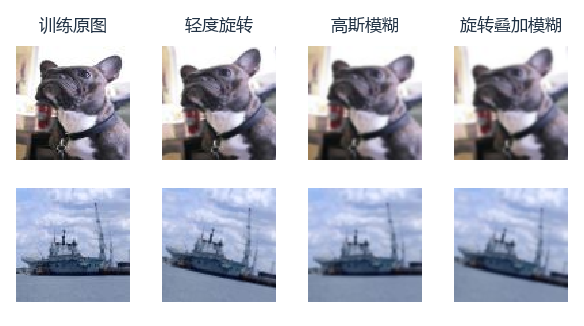

# 在 Windows 笔记本上训练实验四

本轮训练使用 NVIDIA GeForce RTX 4050 Laptop GPU（6 GB），驱动版本 616.56，Python 3.10 和 PyTorch 2.7.1+cu118。11 月 25 日的 Code 43 记录来自原实验机器。

## 统一 256 维课程对照（2026-11-28）

正式的 Baseline / MAML / 校准方案、去训练对齐等五个配对消融及双视图×局部匹配对照均独立列在[统一实验记录](UNIFIED256.md)；该页提供选中权重、逐任务证据、像素重放和重新训练命令。本页以下保留先前各轮研究结果。

## 运行历史局部匹配模型

验证选中的 `regional` 使用图像增强组的自训 ResNet12 权重，并在推理时加入局部区域匹配。固定测试为 **1-shot 74.37%、5-shot 82.64%、两项平均 78.51%**。在已安装依赖的环境中进入仓库的 `源码` 目录，可直接用随仓库提供的权重和图像演示。第一条命令读取 600 个任务/shot 的完整成绩，第二条从像素计算一个 5-shot 示例任务。[环境安装](../../README.md#实验四推理环境) · [验证选型与配对差](#局部监督与区域匹配)

```powershell
python main.py lab04 results --track regional
python main.py lab04 demo --track regional --shots 5 --device cuda
```

发布前用仓库文件重新运行了默认种子 20261122 的 1-shot 和 5-shot 示例。在 Python 3.10、PyTorch 2.7.1+cu118、NumPy 2.2.6、SciPy 1.15.3 环境中，CPU 与 RTX 4050 的两个任务各 75 项预测逐项一致。旧训练环境（NumPy 1.24.3、SciPy 1.10.1）运行同一 1-shot 示例时，两种设备有 3 项预测不同。上面的 `results` 命令读取固定测试任务的归档成绩。

## 90% 目标与课程实验

| 固定测试任务，每种 shot 各 600 个 | 5-way 1-shot | 5-way 5-shot |
|---|---:|---:|
| 原仓库自训 ResNet12 | 56.47% | 68.81% |
| 本机第一轮自训 ResNet12 | 63.48% | 74.29% |
| 本机第二轮自训 ResNet12 | 70.86% ± 1.13% | 79.94% ± 0.66% |
| 本机第三轮自训 ResNet12，续训后使用中心裁剪和近邻图平滑 | 73.75% ± 1.18% | 82.13% ± 0.60% |
| 第四轮，同一骨干，多尺度试验的验证选择 | 73.75% ± 1.18% | 82.18% ± 0.63% |
| 第四轮，同一骨干，再经验证选择原型初始化方式 | 74.12% ± 1.23% | 82.14% ± 0.63% |
| 第五轮，普通续训和自蒸馏对照，验证选回第四轮权重 | 74.12% ± 1.23% | 82.14% ± 0.63% |
| 第六轮，旋转辅助续训，验证选择第 24 轮权重 | **74.56% ± 1.20%** | 82.05% ± 0.64% |
| 第七轮，验证后沿用第六轮模型，两种 shot 共用一套特征 | 74.56% ± 1.20% | 82.05% ± 0.64% |
| 文献方法试验，验证比较任务内 PCA 与支持标签传播，选回第六轮 | 74.56% ± 1.20% | 82.05% ± 0.64% |
| 训练图像增强，续训时增加小角度旋转和轻度高斯模糊 | 73.94% ± 1.21% | 82.18% ± 0.64% |
| 局部区域匹配，验证选中上轮图像增强权重 | 74.37% ± 1.22% | **82.64% ± 0.63%** |
| 冻结 DINOv2 ViT-B/14，外部预训练参考 | 99.55% ± 0.08% | 99.53% ± 0.08% |

第二轮自训在两种设置下分别答对 31,888/45,000 和 35,973/45,000 次查询，比原仓库增加 14.39 和 11.13 个百分点。DINOv2 分别答对 44,798/45,000 和 44,789/45,000 次。在相同验证任务上，自训模型仅使用支持集余弦原型时为 57.22% / 74.69%，加入验证选中的均衡原型更新后为 70.97% / 80.44%。这一对照固定了骨干与图像特征；两轮自训还改变了网络宽度、归一化及训练日程，无法将整个提升归因于单个改动。[自训测试结果](../../outputs/lab04_gpu_medium/results.json) · [自训验证对照](../../outputs/lab04_gpu_medium/validation_lock.json) · [DINOv2 测试结果](../../outputs/lab04_gpu_dino/results.json)

本机对各条路线重放相同的 mini-ImageNet 五分类任务。第二轮模型采用 32/64/128/256 通道的 ResNet12，含 2,018,048 个参数，只用 64 个基础类从头训练。40 轮训练使用交叉熵和增强视图之间的特征均值、方差对齐，最后 8 轮加入小样本任务损失。两个视图的全局特征与基础类学到的空间投影结合，再用支持样本建立类原型。

外部参考冻结 DINOv2 ViT-B/14，将同一批 84×84 图像放大至 224×224，拼接 CLS 向量和平均图块向量。DINOv2 使用外部自监督预训练，预训练数据与本实验图片的逐图重叠未经本项目核验。课程截图指定了轻量 ResNet12、分布对齐及相关消融，DINOv2 的分数用于讨论外部预训练条件下的表现。[DINOv2 模型说明](https://huggingface.co/facebook/dinov2-base/tree/f9e44c814b77203eaa57a6bdbbd535f21ede1415)

在 16 个验证类上，每种 shot 各用 600 个任务比较支持集余弦原型与两种均衡原型更新配置。锁定每种 shot 的最高验证准确率配置后，在 20 个测试类上每种 shot 重放仓库的 600 个任务，每个任务含 75 张查询图。均衡更新联合使用同一任务的无标签查询特征，并使用每类 15 张查询图的先验。查询标签只参与评分。95% 区间描述固定训练权重下的任务间波动。

### 第三轮自训与验证对照

从第二轮第 40 轮的自训权重出发，再用同一批 38,400 张基础类图片训练 30 轮，累计 14 分 37 秒。输入固定为 84×84，交替在普通批次和 CutMix 批次上训练。每个批次另外抽取 32 张图，四种旋转方向各 8 张，让辅助分类头同时预测基础类与旋转方向。训练保留交叉熵、增强视图之间的分布对齐和小样本任务损失，推理时只需一个 ResNet12。特征编码器有 2,001,600 个参数，连同 64 类分类头共 2,018,048 个参数。白化统计和 192 维空间投影只用基础类重新拟合。[续训代码](train_resnet_rotation.py) · [逐轮日志](../../outputs/lab04_gpu_rotation/continuation_training.json)

验证集上让旧权重与续训权重各试两种图像输入（原图及翻转，或再融合 70×70 的中心裁剪及其翻转）和三种分类方式（均衡原型更新、近邻图平滑、近邻图平滑加谱嵌入）。每种 shot 按 600 个任务的正确数选择配置，然后按两种 shot 的正确数之和选择一套共用权重。另记录只用支持图片建立余弦原型的验证准确率，便于观察表征变化。图方法联合使用同一任务内的无标签查询图，并按已知类别均衡分配预测。[评估代码](rotation_study.py) · [全部验证对照](../../outputs/lab04_gpu_rotation/validation_lock.json)

| 同一批验证任务上的对照 | 第二轮 1-shot | 续训后 1-shot | 第二轮 5-shot | 续训后 5-shot |
|---|---:|---:|---:|---:|
| 原图及翻转，只用支持集余弦原型 | 57.22% | 58.60% | 74.69% | 76.20% |
| 原图及翻转，均衡原型更新 | 70.97% | 72.93% | 80.44% | 81.82% |
| 加入中心裁剪与近邻图平滑，均衡分配 | 73.24% | **74.96%** | 81.18% | **82.81%** |

旧配置的两组验证预测共 90,000 项，与第二轮归档逐项一致。保持旧输入和均衡原型更新时，换用续训骨干及其重新拟合的空间投影、白化统计，准确率分别提升 1.96、1.38 个百分点。再在续训模型上加入选中的视图和图方法，分别提升 2.04、1.00 个百分点。增加的 30 轮、CutMix 和旋转辅助任务在同一次训练中启用，各自贡献还需要同训练预算的独立消融。

| 固定测试设置 | 正确查询数 | 比第二轮多答对 | 准确率提升（百分点） | 提升的配对 95% 区间（百分点） |
|---|---:|---:|---:|---:|
| 5-way 1-shot | 33,187 / 45,000 | 1,299 | +2.89 | +2.10 至 +3.67 |
| 5-way 5-shot | 36,957 / 45,000 | 984 | +2.19 | +1.81 至 +2.56 |

从两轮逐图预测独立重算，每种 shot 有 600 个相同测试任务，每个任务有 75 张查询图。两种设置均由验证选中四视图与 7 近邻图平滑，使用每类恰好 15 张查询图的先验。1-shot、5-shot 距 90% 目标分别还有 16.25、7.87 个百分点。本次续训只有一个种子，配对区间刻画同一次训练下的任务波动；这个公开测试集在前几轮实验中也已使用。[测试汇总](../../outputs/lab04_gpu_rotation/results.json) · [逐任务测试预测](../../outputs/lab04_gpu_rotation/test_predictions.json)

在 CPU 和 RTX 4050 上分别抽查两种 shot 的第 0 个固定测试任务。对支持图和查询图分别随机乱序，再重新编号类别，从原图推理后还原顺序，每台设备的 150 个预测均与归档一致。演示可使用 `--device cpu` 或 `--device cuda`。

### 第四轮：固定自训骨干，检验特征与原型初始化

本轮固定第三轮 ResNet12 的全部权重。在 64 个基础类上训练一个 192 维局部特征投影，输入由最后两个残差块的空间分区均值、幂均值和通道协方差组成。验证集比较三组裁剪视图和三档局部特征权重，两种 shot 均选中权重 0。1-shot 保留原有四视图，5-shot 选中加入 58 像素中心裁剪和四角裁剪的 14 视图。两种 shot 的原配置在 90,000 次验证查询上逐图复现了上轮预测。[局部投影训练](train_local_metric.py) · [九组验证对照](../../outputs/lab04_gpu_multiscale/validation_lock.json)

单独改变视图时，1-shot 的固定测试预测与上轮一致。5-shot 的验证从 82.81% 升到 82.94%，测试从 82.13% 升到 82.18%，多答对 23/45,000 次。测试配对提升 0.05 个百分点，95% 区间为 −0.21 至 +0.31 个百分点。四角裁剪的收益与增加的推理开销应一并考虑。[裁剪试验测试结果](../../outputs/lab04_gpu_multiscale/results.json)

随后固定验证选中的视图，改变均衡原型更新的起点。对照保留由支持集得到的类原型。两个候选还分别从同一任务的无标签查询特征构造六组起点，用支持集把初始聚类与类别对应，按同一任务上的熵正则化聚类目标选择一个解或对七个解的分类概率加权。每种 shot 仅在验证任务上选择一次；如果选回相同规则，直接沿用已锁定的测试预测。[原型初始化实现](prototype_restarts.py) · [验证选择](../../outputs/lab04_gpu_restarts/validation_lock.json)

| 同一批 600 个五分类任务，每类查询数 15 | 第三轮测试 | 第四轮最终验证 | 第四轮最终测试 | 比第三轮多答对 | 测试配对差及 95% 区间（百分点） |
|---|---:|---:|---:|---:|---:|
| 1-shot，四视图，按目标函数选择起点 | 73.75% | 75.59% | 74.12% | 169 / 45,000 | +0.38［−0.10，+0.85］ |
| 5-shot，14 视图，七个解的概率加权 | 82.13% | 82.96% | 82.14% | 6 / 45,000 | +0.01［−0.25，+0.27］ |

1-shot 最终测试答对 33,356 次，5-shot 答对 36,963 次。两项提升区间都跨过零。验证中多起点对 1-shot 的提升较大，5-shot 的最终方案只比同视图单起点多答对 7 次验证查询。表中选择全部来自验证集。两组测试结果分开报告，同一组已公开的测试任务在前几轮也使用过；配对区间只刻画这套训练权重在任务之间的波动。抽查两种 shot 的第一个固定测试任务，把图片乱序、重新编号标签后，从原图在 CPU 和 GPU 分别推理，每台设备的 150 项预测都与归档一致。[第四轮测试汇总](../../outputs/lab04_gpu_restarts/results.json) · [逐图预测](../../outputs/lab04_gpu_restarts/test_predictions.json)

在本机 RTX 4050 上，固定同一个演示任务（种子 20261122），模型预加载后先预热一次，交替测量两种方案各五次，前后均同步 CUDA。原图编码至输出预测的中位时间，1-shot 从第三轮的 281 毫秒增至 306 毫秒，5-shot 从 322 毫秒增至 1,042 毫秒。计时只覆盖这两个任务。

### 第五轮训练对照

两组从相同的自训 ResNet12 权重出发，各用 38,400 张基础类图像训练 16 轮，共更新 4,800 次。两组使用相同的种子、批次、裁剪、CutMix 和 AdamW 余弦学习率。每批 128 张原图中有 32 张另取一次随机增强视图。普通批次计算分类交叉熵、两视图的特征均值和方差对齐，以及五分类小样本任务损失。每四批有一批使用 CutMix 和覆盖面积加权的分类目标。本轮续训阶段去掉了先前的旋转辅助分类头。

自蒸馏组另外用冻结的上一轮自训权重预测基础类图像，将原图及水平翻转的 64 类软标签取平均。学生的 KL 损失使用温度 3、权重 0.7，CutMix 样本按实际覆盖面积混合软标签。普通组的逐轮训练合计 427.06 秒，蒸馏组为 426.54 秒，生成教师软标签另用 14.44 秒。两组均只导出一个轻量 ResNet12，白化与空间投影分别在基础类上重新拟合。[训练实现](train_self_distill.py) · [两组逐轮日志](../../outputs/lab04_gpu_self_distill/training.json)

| 同一批验证任务 | 沿用第四轮推理，1-shot | 沿用第四轮推理，5-shot | 仅支持集余弦原型，1-shot | 仅支持集余弦原型，5-shot |
|---|---:|---:|---:|---:|
| 上一轮权重 | **75.59%** | **82.96%** | 59.97% | 76.96% |
| 普通续训 | 74.88% | 82.14% | 60.02% | 76.53% |
| 自蒸馏续训 | 75.24% | 82.51% | 60.33% | 77.06% |

自蒸馏相对普通续训多答对 164 / 165 次验证查询，配对差为 +0.36 个百分点（95% 区间 −0.28 至 +1.01）和 +0.37 个百分点（+0.15 至 +0.58）。相对上一轮权重，蒸馏组少答对 155 / 201 次。仅用支持集建余弦原型时，蒸馏组的两项均值略高，选择模型使用表中前两列预先固定的完整推理方式。两项正确数之和以上一轮权重最高。每种 shot 各 600 个五分类任务、45,000 次查询。区间按任务配对计算，两组各使用一个相同的训练种子。[评估实现](self_distill_study.py) · [验证对照与锁定记录](../../outputs/lab04_gpu_self_distill/validation_lock.json)

上一轮模型从验证原图重放的 90,000 个预测与历史归档逐项一致。入选的权重、特征变换、视图和原型更新方法均与第四轮相同，测试直接复用第四轮归档，重新计数得到 33,356/45,000（74.12%）和 36,963/45,000（82.14%）。两个新候选只在验证集上比较。将每种 shot 的第一个测试任务打乱顺序、重新编码支持标签后，用导出模型从原图分别在 CPU 和 RTX 4050 上重放，两种设备的 150 项预测各自与归档一致。[测试汇总](../../outputs/lab04_gpu_self_distill/results.json)

### 第六轮旋转辅助训练

从第三轮的 2,018,048 参数 ResNet12 和已训练的联合分类头出发，取每批中 16 张图的四种旋转视图，同时预测基础类别和旋转方向。对同一图片从每个方向取出与已知旋转角对应的 64 个类别分数，平均后经温度 2 的 softmax 生成目标，让原图的类别预测学习这份软标签。训练保留交叉熵、分布对齐、CutMix 和五分类任务损失，全部图像来自 64 个基础类。一个种子共 24 轮、7,200 次更新，在 RTX 4050 上各轮耗时合计 804.77 秒。[训练实现](train_rotation_views.py) · [训练日志](../../outputs/lab04_gpu_rotation_views/training.json)

同一条训练轨迹导出第 24 轮权重和第 13 至 24 轮等权平均的权重。两者分别用 38,400 张基础类原图及其水平翻转更新批归一化统计，另耗时 26.05 和 26.04 秒。每个骨干分别从基础类拟合白化统计和空间投影。验证和部署继续使用第四轮锁定的图像视图、均衡原型和多起点规则。旋转分类头只在训练阶段使用。

| 固定验证任务 | 完整推理 1-shot | 完整推理 5-shot | 仅支持集原型 1-shot | 仅支持集原型 5-shot |
|---|---:|---:|---:|---:|
| 上一轮选中的模型 | 75.59% | 82.96% | 59.97% | 76.96% |
| 第 24 轮 | 76.57% | 83.43% | 61.11% | 77.62% |
| 最后 12 轮权重平均 | 76.62% | 83.34% | 61.06% | 77.61% |

选择标准为两种 shot 在完整推理下的验证正确数之和。末轮权重共答对 72,002 次，平均权重 71,985 次，旧模型 71,344 次。锁定末轮权重后，仅该候选进入测试。平均权重只参加验证。两种 shot 使用同一个模型。[验证锁与全部候选](../../outputs/lab04_gpu_rotation_views/validation_lock.json) · [评估代码](rotation_views_study.py)

| 固定测试任务 | 上一轮 | 第六轮 | 查询正确数变化 | 配对差及 95% 区间（百分点） |
|---|---:|---:|---:|---:|
| 1-shot | 74.12% | 74.56% | 33,356 → 33,550 | +0.43［−0.31，+1.17］ |
| 5-shot | 82.14% | 82.05% | 36,963 → 36,923 | −0.09［−0.38，+0.20］ |

每种 shot 各 600 个任务、45,000 次查询，两项测试差的区间均跨零。验证提升较大，测试上的 5-shot 均值略降。区间来自固定模型在同一批任务上的配对比较，这些测试任务已用于前几轮。训练同时改变了辅助损失、训练步数和批归一化统计，各自贡献尚待独立消融。逐图独立复算确认全部正确数、配对差和区间。打乱图片顺序并重新编码支持标签后，在 CPU 和 RTX 4050 各重放每种 shot 的首个任务，每台设备 150 个预测与归档一致。[测试汇总](../../outputs/lab04_gpu_rotation_views/results.json) · [逐图预测](../../outputs/lab04_gpu_rotation_views/test_predictions.json)

### 第七轮特征度量与空间池化

固定第六轮在本机自训的 ResNet12，只用 64 个基础类的 38,400 张图片学习新特征。两个残差投影各增加 57,408 个可训练参数，各用相同的 9,600 个训练任务。两者都用查询分类交叉熵、原图与中心裁剪的特征均值和标准差对齐，并约束新特征与原特征的距离。第一种直接从有标签支持样本建立原型。第二种在算交叉熵前，额外用任务内无标签查询特征更新三次原型。另一个参照方法从同图的两种视图估计差值的协方差，对裁剪时变化较大的特征方向降低权重。[度量训练](train_episode_metric.py) · [训练记录](../../outputs/lab04_gpu_episode_metric/training.json)

空间池化实验直接读取最后一层的 256×5×5 特征图。先将 256 个通道投影到 48 个，计算通道在 25 个空间位置上的响应距离，对距离矩阵按行列中心化，再投影到 192 维。在 5,600 个基础类任务上训练该模块，包含 238,176 个可训练参数。候选模型在原有推理之外，对原图及其翻转再各跑一次同一骨干，用两次结果的归一化和构建空间特征。预设空间特征在相似度中的占比为 0%、25%、50%。[空间池化与训练](distance_covariance.py) · [训练记录](../../outputs/lab04_gpu_distance_covariance/training.json)

| 同一批固定验证任务 | 1-shot | 5-shot | 两种 shot 合计正确数 / 90,000 |
|---|---:|---:|---:|
| 第六轮模型 | **76.57%** | 83.43% | **72,002** |
| 仅支持原型训练的度量 | 76.17% | 83.26% | 71,747 |
| 更新三次原型后训练的度量 | 76.18% | 83.39% | 71,805 |
| 按裁剪差异的协方差校准 | 76.03% | 82.98% | 71,554 |
| 空间特征占 25% | 76.34% | **83.56%** | 71,958 |
| 空间特征占 50% | 74.24% | 82.17% | 70,381 |

两个实验都预先指定按两种 shot 的验证正确总数选择一套特征。空间特征占 25% 时，5-shot 相对第六轮多答对 59/45,000 次，配对差 +0.13 个百分点，95% 区间 [−0.09，+0.35]。同一候选在 1-shot 少答对 103 次，配对差 −0.23 个百分点，95% 区间 [−0.90，+0.44]。两个实验均选回第六轮。分别从原图重算后，在固定测试任务上，1-shot 答对 33,550/45,000 次，5-shot 答对 36,923/45,000 次，每个查询的预测均与第六轮一致。每种 shot 各 600 个均衡五分类任务，同一任务的查询可以共同参与原型更新，查询真标签用于评分。这些公开测试任务在前几轮已使用，结果基于同一个骨干训练种子。[度量验证比较](../../outputs/lab04_gpu_episode_metric/validation_lock.json) · [空间池化验证比较](../../outputs/lab04_gpu_distance_covariance/validation_lock.json) · [固定测试结果](../../outputs/lab04_gpu_distance_covariance/results.json)

另在原有的 16 个验证类上，用新种子 840517 重新抽取 600 个 5-shot 任务，专门比较 25% 空间特征。原模型答对 37,621/45,000 次（83.60%），加入空间特征后答对 37,676 次（83.72%）。配对差为 +0.12 个百分点，95% 区间 [−0.09，+0.34]。这次抽样与第一批使用相同的类和图像池，只更换任务组合。按复核前记录的规则，配对区间下界超过零才将 25% 权重送入测试。本轮继续使用第六轮模型，25% 方案的测试准确率尚未测量。[复核方案](../../outputs/lab04_gpu_distance_5shot/plan.json) · [逐任务复核结果](../../outputs/lab04_gpu_distance_5shot/confirmation.json)

### 最后一轮文献方法与最终成绩

在同一套自训 ResNet12 上比较两种任务内校准。Lichtenstein 等人的 TAFSSL 在当前支持集和无标签查询集上估计 PCA 或 ICA 子空间。本轮保留前 7 个主成分，与原有的均衡原型分类配合。Lazarou 等人的 iLPC 在近邻图上传播支持标签，并迭代筛选伪标签。本轮借用其中的标签传播，在 7 近邻图上解线性方程，将传播得到的五维特征与图像特征融合。两种实现均保留本项目的自适应原型、推理视图及均衡查询设定，新增可训练参数为零。实验只使用基础类训练出的骨干和校准权重。[TAFSSL 原论文](https://arxiv.org/abs/2003.06670) · [iLPC 原论文](https://openaccess.thecvf.com/content/ICCV2021/html/Lazarou_Iterative_Label_Cleaning_for_Transductive_and_Semi-Supervised_Few-Shot_Learning_ICCV_2021_paper.html) · [实现](task_subspace.py)

| 同一批固定验证任务 | 1-shot | 5-shot |
|---|---:|---:|
| 第六轮特征和原型 | **76.57%** | **83.43%** |
| 原特征与 PCA 投影各占一半 | 74.98% | 82.21% |
| 仅使用 PCA 投影 | 74.34% | 81.58% |
| 加入支持标签传播特征 | 73.51% | 81.41% |
| 同时使用 PCA 投影和标签传播特征 | 74.55% | 82.40% |

每种 shot 各 600 个固定验证任务。预先约定每种 shot 各选正确数最多的一项，新方法还须在另抽的 600 个同类验证任务中通过配对复核。第一阶段两项均由第六轮胜出，复核与测试重放均沿用第六轮。未入选的四个新配置只参与固定验证。表中的比较只针对所列设置与这套骨干。[预先记录的规则](../../outputs/lab04_gpu_task_subspace/plan.json) · [固定验证逐项结果](../../outputs/lab04_gpu_task_subspace/shortlist.json) · [最终配置](../../outputs/lab04_gpu_task_subspace/validation_lock.json)

截至此次文献方法试验，按两种 shot 等权计算，第六轮以 **78.30%** 排第一，后两轮沿用了这套模型。它的 1-shot 和 5-shot 分别为 **74.56%** 和 **82.05%**。第四轮多尺度方案在 5-shot 达到 **82.18%**，该方案同次 1-shot 为 73.75%。测试任务在历次实验间重复使用。固定权重下按任务计算的区间未计入不同训练种子的波动。[第六轮原始结果](../../outputs/lab04_gpu_rotation_views/results.json) · [第四轮多尺度结果](../../outputs/lab04_gpu_multiscale/results.json) · [文献方法试验的测试重放](../../outputs/lab04_gpu_task_subspace/results.json)

已有归档可在源码目录用下列 PowerShell 命令查看或演示。完整重跑命令会用相同固定任务重新选型。

```powershell
python main.py lab04 results --track task_subspace
python main.py lab04 demo --track task_subspace --shots 5 --device cuda
python -u -m experiments.lab04.task_subspace_study --output .local/replay-task-subspace
```

### 训练图像增强对照

在同一台 RTX 4050 上，从第六轮验证选中的同一份轻量 ResNet12 权重及配套旋转辅助头出发，运行两组等预算续训。两组各跑 6 轮，每轮用遍 64 个基础类的 38,400 张原图，使用相同的批次、基础增强随机数、学习率和损失函数。对照组使用原来的裁剪、翻转、颜色扰动、CutMix 和四方向辅助任务。实验组在基础视图上独立抽取两种额外变换：

- 每张图有 40% 概率旋转，角度在 −12° 到 +12° 之间均匀抽取。双线性插值配反射边界。
- 每张图有 20% 概率进行高斯模糊，使用 3×3 卷积核，标准差为 0.8 像素。两种操作可以叠加。

训练时在 GPU 内存中按批生成视图，同一张图每轮都可能有不同外观。下图从训练集中取两张原图，用实际增强函数分别演示旋转、模糊和叠加的效果。验证和测试继续使用原先锁定的推理视图。



| 固定验证任务，各 45,000 次判定 | 5-way 1-shot | 5-way 5-shot |
|---|---:|---:|
| 第六轮原权重 | 76.57% | 83.43% |
| 相同预算续训，原有增强 | 76.55% | 83.28% |
| 相同预算续训，再加轻度旋转与模糊 | **76.63%** | **83.57%** |

增强组与对照组各完成 1,800 次更新。增强组共访问训练图 230,400 次，其中 92,617 次执行了额外旋转，46,245 次执行了模糊。与等预算对照组相比，1-shot 多答对 37 次，配对提升 0.08 个百分点（95% 区间 −0.50 至 +0.66）。5-shot 多答对 132 次，配对提升 0.29 个百分点（95% 区间 +0.09 至 +0.49）。两种增强在同一组启用，因此只能估计它们的合计效果。区间按固定权重下的 600 个任务计算。[训练日志](../../outputs/lab04_gpu_image_augmentation/training.json) · [验证选择](../../outputs/lab04_gpu_image_augmentation/validation_lock.json)

验证正确数之和为增强组 72,091、第六轮 72,002、等预算对照组 71,922。按预先记录的规则选中增强组后，在固定测试任务上得到 **1-shot 73.94%**（33,271/45,000）、**5-shot 82.18%**（36,981/45,000）。相对第六轮，1-shot 少答对 279 次，差 −0.62 个百分点，配对 95% 区间为 −1.19 至 −0.05。5-shot 多答对 58 次，差 +0.13 个百分点，配对 95% 区间为 −0.14 至 +0.40。第四轮多尺度模型也显示 82.18%，准确计数为 36,980/45,000。两种 shot 的等权测试平均为增强组 78.06%、第六轮 78.30%。本次使用一个训练种子，沿用此前的固定测试任务。[测试结果](../../outputs/lab04_gpu_image_augmentation/results.json) · [逐任务预测](../../outputs/lab04_gpu_image_augmentation/test_predictions.json)

本机 PowerShell 在源码目录执行以下命令即可复跑。第一步读取第六轮保存的训练状态，第二步重新拟合两组各自的基础类特征校准，并在相同的 600 个 1-shot 和 600 个 5-shot 验证任务上，与第六轮比较两项正确数之和。

```powershell
$env:OPENBLAS_NUM_THREADS = '1'
$env:MKL_NUM_THREADS = '1'
$env:OMP_NUM_THREADS = '2'
python -u -m experiments.lab04.train_image_augmentation
python -u -m experiments.lab04.image_augmentation_study
python main.py lab04 results --track image_augmentation
```

### 局部监督与区域匹配

在本机 RTX 4050 上，将上轮图像增强组作为等预算对照。从相同的第六轮自训权重和辅助旋转头出发，复用 6 轮的样本顺序、增强种子和骨干学习率，训练仍只用 64 个基础类。新训练组在第三个残差块的输出上划分 3×3 个区域，对每张单标签图选取目标类别交叉熵最低的 6 个区域求平均，损失权重为 0.35。每轮 300 步中有 150 步使用局部监督，其余为 CutMix 步。6 轮骨干更新共耗时 206.71 秒，区域交叉熵由 3.95 降到 3.12。[训练实现](train_regional.py) · [逐轮日志](../../outputs/lab04_gpu_regional/training.json)

另用相同的两个骨干比较区域匹配。把原图及翻转图第三个残差块的输出对齐，池化为 9 个局部描述子。在每个五分类任务里，将描述子中心化，计算两张图所有区域对的指数核相似度并取平均。图像相似度由原来的全局特征占 80%、区域匹配占 20% 构成，再运行原有的均衡原型分类。两种 shot 共用一个骨干和同一混合权重，沿用各自的视图与原型初始化规则。[推理实现](regional_kernel.py)

| 固定验证任务，每种 shot 各 45,000 次判定 | 1-shot | 5-shot | 两项正确数之和 |
|---|---:|---:|---:|
| 第六轮 | 76.57% | 83.43% | 72,002 |
| 上轮图像增强 | 76.63% | 83.57% | 72,091 |
| 局部监督训练 | 76.38% | 83.48% | 71,934 |
| 上轮图像增强＋区域匹配 | 76.90% | 83.60% | **72,223** |
| 局部监督训练＋区域匹配 | 76.93% | 83.52% | 72,205 |

按两项验证正确数之和选择上轮增强权重加区域匹配，领先第二名 18 次。局部监督单独加入训练后，在相同推理方式下，1-shot 和 5-shot 的验证正确数分别少了 116 和 41 次。原图重放核对了上轮增强组的全部 90,000 项验证预测。[评估实现](regional_study.py) · [验证选择](../../outputs/lab04_gpu_regional/validation_lock.json)

| 固定测试任务 | 正确数 | 准确率 | 相对上轮增强的配对差，百分点（95% 区间） | 相对第六轮的配对差，百分点（95% 区间） |
|---|---:|---:|---:|---:|
| 1-shot | 33,467 / 45,000 | 74.37% | +0.44（−0.08 至 +0.95） | −0.18（−0.85 至 +0.48） |
| 5-shot | 37,189 / 45,000 | 82.64% | +0.46（+0.29 至 +0.64） | +0.59（+0.33 至 +0.85） |

在这批公开测试任务上，同一套模型两种 shot 等权平均为 78.51%，第六轮为 78.30%，上轮增强为 78.06%。移除区域匹配的对照与本轮选中模型共用相同权重。以上区间按同一训练种子下的任务配对计算，历轮反复使用了这套测试任务。[测试汇总](../../outputs/lab04_gpu_regional/results.json) · [逐任务预测](../../outputs/lab04_gpu_regional/test_predictions.json)

锁定模型前还登记了一组新验证任务的随机种子。在相同的 16 个验证类上，每种 shot 重新抽取 600 个任务，固定使用已选中的模型。上轮增强与加入区域匹配的 1-shot 为 76.57% 和 76.48%，配对差 −0.09 个百分点（95% 区间 −0.62 至 +0.44）。5-shot 为 83.78% 和 83.88%，配对差 +0.10 个百分点（−0.08 至 +0.27）。这组复核支持把固定测试上的提高解释为小幅改进，1-shot 的差值随所抽任务改变方向。已从保存的预测及任务标签复算所有固定评估结果，使用抽样种子重建全部新验证任务，并在 CPU、RTX 4050 上分别重放了两个打乱顺序和重新编码支持标签的测试任务，每台设备的 150 项预测与归档一致。[复核结果](../../outputs/lab04_gpu_regional/confirmation.json) · [新任务及逐图预测](../../outputs/lab04_gpu_regional/confirmation_predictions.npz)

要重跑局部监督训练，需要完整 mini-ImageNet 和第六轮的续训状态 `.local/lab04-rotation-views/resume.pt`。训练脚本会校验增强组对照所记录的骨干和续训状态指纹、GPU 型号、PyTorch 版本及训练精度。在另一套环境重做这组对照时，应先用该环境生成相互匹配的前序训练记录，再向训练与评估入口传入对应目录。以下命令从 `源码` 目录执行，使用原实验的对照记录，评估与复核写入新的本地目录。读取成绩和运行演示只需本文开头的命令。

```powershell
$env:OPENBLAS_NUM_THREADS = '1'
$env:MKL_NUM_THREADS = '1'
$env:OMP_NUM_THREADS = '2'
python -u -m experiments.lab04.train_regional
python -u -m experiments.lab04.regional_study --output .local/replay-regional
python -u -m experiments.lab04.confirm_regional --output .local/replay-regional
```

### 复跑与演示

本机 PowerShell 命令如下。训练入口强制使用 CUDA，训练中断后可用相同命令从最近完成的一轮恢复。

```powershell
python -u -m experiments.lab04.train_medium_gpu
python -u -m experiments.lab04.evaluate_gpu_tracks medium
python main.py lab04 results --track medium
python main.py lab04 demo --track medium --shots 5 --device cuda
```

要复跑第三轮，先准备上表第二轮的本机自训权重及数据。下面第一条命令从该权重续训 30 轮，第二条命令在训练类上拟合特征变换，并依次完成验证选型、锁定和测试。已经有第三轮结果时，可直接用最后两条命令查看成绩及运行演示。

```powershell
python -u -m experiments.lab04.train_resnet_rotation
python -u -m experiments.lab04.rotation_study
python main.py lab04 results --track rotation
python main.py lab04 demo --track rotation --shots 5 --device cuda
```

第四轮直接加载第三轮的自训 ResNet12。先用基础类训练局部特征投影，再比较不同裁剪视图和投影权重。结果与前几轮分别保存。

```powershell
python -u -m experiments.lab04.train_local_metric
python -u -m experiments.lab04.multiscale_study
python main.py lab04 results --track multiscale
python main.py lab04 demo --track multiscale --shots 5 --device cuda
```

原型多起点的研究复用上述多尺度实验的权重目录和验证锁。以下命令分别重放选型与测试、展示汇总和运行原图演示。

```powershell
python -u -m experiments.lab04.prototype_restarts
python main.py lab04 results --track restarts
python main.py lab04 demo --track restarts --shots 1 --device cuda
```

第五轮从第三轮骨干各续训 16 轮，普通续训和自蒸馏使用相同的随机种子和图像批次。复用第四轮验证锁中的视图和原型更新方法。结果与演示中的 `winner` 表示验证选中的骨干，`parent` 为第四轮，`control` 为普通续训，`distill` 为自蒸馏。已下载数据和归档齐全时，可直接从源码目录运行最后两条命令。

```powershell
python -u -m experiments.lab04.train_self_distill
python -u -m experiments.lab04.self_distill_study
python main.py lab04 results --track self_distill
python main.py lab04 demo --track self_distill --shots 5 --device cuda
```

第六轮从第三轮训练保存的联合分类头和骨干继续训练。上文第三轮训练命令会生成所需的 `.local/lab04-rotation/resume.pt`。推理只加载验证选中的一套权重及配套校准文件。

```powershell
python -u -m experiments.lab04.train_rotation_views
python -u -m experiments.lab04.rotation_views_study
python main.py lab04 results --track rotation_views
python main.py lab04 demo --track rotation_views --shots 5 --device cuda
```

第七轮的两个实验可分别运行，都读取第六轮的已导出权重和本机 mini-ImageNet。默认输出目录已有成绩时，命令会校验文件。以下命令用新的输出目录重跑训练和验证。演示加载已归档的验证赢家。

```powershell
$env:OPENBLAS_NUM_THREADS = '1'
$env:MKL_NUM_THREADS = '1'
$env:OMP_NUM_THREADS = '2'
python -u -m experiments.lab04.episode_metric_study --output .local/replay-episode-metric
python -u -m experiments.lab04.distance_covariance_study --output .local/replay-distance-covariance
python -u -m experiments.lab04.confirm_distance_5shot --source .local/replay-distance-covariance --output .local/replay-distance-5shot
python main.py lab04 results --track distance_covariance
python main.py lab04 demo --track distance_covariance --shots 5 --device cuda
```

DINOv2 的权重及可选 Python 依赖已缓存在本机。演示命令从原图执行推理。结果命令显示固定任务上的完整评分。

```powershell
$env:PYTHONPATH = (Resolve-Path '.local/dino-runtime').Path
python -u -m experiments.lab04.evaluate_gpu_tracks dino
python main.py lab04 results --track dino
python main.py lab04 demo --track dino --shots 5 --device cuda
```

其他机器先安装与驱动匹配的 PyTorch，按下文准备数据。如需复现外部参考，可在所用 Python 环境中安装 `transformers==4.48.3` 和 `safetensors==0.5.3`，再运行以下命令获取同一版本的权重。评估程序会校验配置与权重的 SHA-256。两条评估路线均使用第一轮自训的 `outputs/lab04_gpu_fresh` 结果做逐任务配对。

```powershell
python -c "from huggingface_hub import snapshot_download; snapshot_download('facebook/dinov2-base', revision='f9e44c814b77203eaa57a6bdbbd535f21ede1415', allow_patterns=['config.json', 'model.safetensors'], local_dir='.local/dinov2-base')"
```

## 第一轮 GPU 自训成绩

| mini-ImageNet 划分与模型 | 5-way 1-shot | 5-way 5-shot |
|---|---:|---:|
| 验证集，原仓库 continued | 56.15% | 69.20% |
| 验证集，新骨干配全局平均池化 | 61.10% | 73.01% |
| 验证集，新骨干配全局与空间特征 | 63.36% | 74.64% |
| 测试集，原仓库 continued | 56.47% | 68.81% |
| 测试集，验证选中的新模型 | **63.48%** | **74.29%** |

测试时两种 shot 各有 600 个任务、45,000 次查询判定。新模型分别答对 28,565 和 33,430 次，旧模型分别答对 25,413 和 30,966 次。逐任务配对提升为 **7.00 个百分点**（95% 区间 5.93 至 8.08）和 **5.48 个百分点**（95% 区间 4.94 至 6.01）。同一张图可以出现在多个任务里。[汇总结果](../../outputs/lab04_gpu_fresh/results.json) · [逐任务测试预测](../../outputs/lab04_gpu_fresh/test_predictions.json)

骨干保留 509,856 个参数，空间投影另有 390,144 个参数。36 轮 GPU 骨干训练累计 16 分 13 秒。部署所需的骨干、投影、白化统计合计 3,748,848 字节，另需加载验证锁中的推理配置。抽查两个验证任务时，从原图在 CPU 和 GPU 各跑一遍，150 个预测与保存记录逐项一致。[训练日志](../../outputs/lab04_gpu_fresh/backbone_training.json) · [推理配置](../../outputs/lab04_gpu_fresh/validation_lock.json)

原实验在基础类未增强训练图上的 64 类分类准确率为 63.80%，本次为 60.49%。同一位置的相邻通道相关系数均值从 0.995 降到 −0.066。这些数值与上表的小样本准确率分别计算。本次同时改变了初始化、训练日程与任务损失，逐项归因仍需同预算消融。[原训练诊断](../../outputs/lab04/next_study/requirement_accuracy_20261125/train_representation_diagnostic.json)

## 准备数据与复跑第一轮

在已激活 Python 环境的 PowerShell 中，从仓库的 `源码` 目录执行以下命令。第一次需要下载 mini-ImageNet，解压及校验 60,000 张图片。已经准备过的数据可以复用。

```powershell
$env:OPENBLAS_NUM_THREADS = '1'
$env:MKL_NUM_THREADS = '1'
$env:OMP_NUM_THREADS = '2'
python -c "import torch; print(torch.__version__, torch.cuda.get_device_name(0))"
python -m experiments.lab04.prepare_data --root .local/mini-imagenet
python -u -m experiments.lab04.train_gpu_backbone
python -u -m experiments.lab04.train_gpu_metric --device cuda
```

骨干训练入口强制使用 CUDA。每轮结束后保存模型和优化器，再次执行同一训练命令可从上一完整轮继续。评估入口会在 `outputs/lab04_gpu_fresh` 生成权重、验证选择记录、准确率和逐任务预测。训练时可以在另一窗口运行 `nvidia-smi -l 2` 查看本机显卡负载。

## 第一轮训练与评测口径

- 保留原轻量 ResNet12 的四组通道宽度 16/32/64/128，独立初始化全部卷积。训练数据只使用互斥划分中的 64 个基础类，共 38,400 张图，每轮访问每张图一次。
- 笔记本预算为一个骨干训练种子、32 轮基础分类和 4 轮小样本微调。分类使用交叉熵和成对增强视图的均值、方差对齐。微调保留这两项并加入交替 1-shot/5-shot 的五分类任务损失。前期逐步从 40 提高到 84 像素，评估统一使用 84 像素。使用 BF16 混合精度训练，提取评估特征时使用 FP32。
- 骨干训练结束后，在基础类上拟合白化变换，并训练一个可选的空间统计投影。验证集比较全局平均池化特征与加入空间投影的组合。两个方案共用同一个骨干、支持集、查询集和原仓库的均衡原型更新配置。
- 以 GPU 试验开始前的自训权重 `continued.pt` 的归档预测为对照。在 16 个验证类上，每种 shot 重放相同的 600 个五分类任务。两种 shot 均提升至少 1 个百分点、且配对 95% 区间下界均大于零的候选中，选择两项平均准确率最高者。仅该候选进入 20 个测试类，同样每种 shot 600 个任务，每类 15 张查询图。
- 预测可以联合使用同一任务内的无标签查询特征，并利用查询类别均衡的设定。查询标签仅用于评分。测试划分此前已被原仓库使用，配对区间描述这些任务上的波动，多训练种子的波动需要单独测量。

## 在 Python 中加载历史局部匹配模型

下面的调用直接从 RGB 像素预测。输入数组为 `uint8`，形状为 `(N, 84, 84, 3)`。一个任务有 5 个类，每类 1 或 5 张支持图，查询集按类均衡。返回值与 `support_labels` 使用相同的类别编号。

```python
from experiments.lab04.regional_kernel import RegionalClassifier

model = RegionalClassifier("outputs/lab04_gpu_regional", device="cuda")
predictions = model.predict(support_images, support_labels, query_images)
```

同一组导出的权重也支持 `device="cpu"`。
